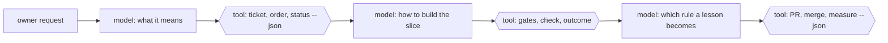
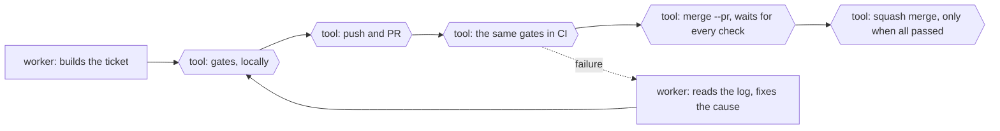

# About forger

This page explains the ideas behind forger. To install and start, read the
[README](README.md) and [`docs/getting-started.md`](docs/getting-started.md).

Deterministic tools and skills that let any model forge ahead reliably:
an unattended development loop in which a worker builds one ticket at a time, a
supervisor turns the owner's requests into tickets and watches the work land, and
a refinement loop turns every correction and every failure into a better process.

At its core, forger reaches for determinism. Anything that must come out the
same every time is a tested command; models reason only where judgement is
needed, between hard boundaries the tools enforce. Because the decisions live in
the tools, the model and the harness that runs it are interchangeable. See
[`docs/01-principles.md`](docs/01-principles.md), principles 0 and 0a.

Hexagons are tools: tested commands with machine-readable output that the model
calls and cannot talk its way around. Rectangles are judgement.

## Skills from the community

Forger carries its own step for every judgement point, and it incorporates the
skill collections you already use. Install one, pick its flavour, and the loop
runs its skills at the stages they fit, unattended.

| Collection | What it is | Stance | Slots it fills | Harnesses |
|---|---|---|---|---|
| [agent-skills](https://github.com/addyosmani/agent-skills) | A lifecycle pack of process skills with steps, red flags and exit criteria | A human checkpoint at each phase | interview, glossary, test_first, review, diagnose, risk | several, listed on its page |
| [mattpocock-skills](https://github.com/mattpocock/skills) | Small composable skills from one engineer's daily set | Skills hold discipline, not the process | interview, glossary, test_first, review, diagnose, pr_body, retro | several, listed on its page |
| [pstack](https://github.com/cursor/plugins/tree/main/pstack) | One engineer's stack: go deep, prove every claim | Verify against the real thing; no planning skills | test_first, review, risk, retro (all by file) | several, listed on its page |

They differ in who holds the process: agent-skills walks a human through phases,
mattpocock-skills leaves the process to you, and pstack proves claims by running
them. Forger holds the process, so it takes the skills and never their routers or
loops. A `mixed` flavour takes the strongest fit per slot across all three.

Pages: [agent-skills](docs/skills/agent-skills.md), [mattpocock-skills](docs/skills/mattpocock-skills.md), [pstack](docs/skills/pstack.md), and
[automating the skills through the factory](docs/skills/README.md).

The goal is a loop that heals itself, learns and adapts: each lesson climbs from
a note to a rule, a template, a check and finally a tool, until it holds without
anyone remembering it, and the process is measured by commands, not claims.

## Quality is asserted by commands

The gates a worker runs before it pushes are the gates CI runs on every push and
pull request: the workflow's step is the `gates` command from
`.forger/workloop.config.json`, verbatim, and a test fails if the two drift
apart. The job summary lists each check with the opinion ids it enforces,
whether it passed, failed or was waived, and the waivers in force, so a reader
sees which opinions hold, not just a green tick. The worker merges only through
`merge --pr <n>`, which waits for every check to finish and refuses a red PR;
a merge that lands on red anyway halts the loop.

## The three layers

| Layer | Who runs it | What it does | Where it lives here |
|---|---|---|---|
| **Engine and worker** | a detached engine, headless sessions | picks the next ticket, runs one worker per ticket under a budget, counts outcomes, halts on trouble | `plugins/forger/` |
| **Supervisor** | an interactive session with the owner | intake, ordering, dispatch, watching, verifying, reporting | `docs/04-supervising.md` |
| **Refinement** | the supervisor, within the owner's approval policy | turns corrections, failures and friction into rules, templates, checks and tools | `docs/05-refining-the-process.md` |

## Bring your own skills

Forger depends on no skill collection, and it incorporates any you install. The
points where a model does judgement work (interview, glossary, test-first,
review, diagnosis, merge conflicts) are named **skill slots**. Each has a
built-in forger step, and you map an installed skill onto a slot in the `skills`
section of `.forger/workloop.config.json`. The commands never name a skill: they
ask `skills --json` what each slot resolves to, and fall back to the built-in
step when a slot is unmapped or its skill is missing.

Each collection above has a ready-made preset (a flavour) that maps it onto the
slots, and `/forger:setup` offers it when the collection is installed. The slots, the config and the preset are described in
[`docs/reference/skill-slots.md`](docs/reference/skill-slots.md).

## Read in this order

0. [`docs/reference/`](docs/reference/README.md) - the plugin: commands, configuration, tracker, skill slots, install.
1. [`docs/01-principles.md`](docs/01-principles.md) - the few ideas everything else follows from.
2. [`docs/02-the-loop.md`](docs/02-the-loop.md) - roles, files, states and invariants.
3. [`docs/03-tickets.md`](docs/03-tickets.md) - what a good ticket and a good PR carry.
4. [`docs/04-supervising.md`](docs/04-supervising.md) - the supervisor's playbook, layer by layer.
5. [`docs/05-refining-the-process.md`](docs/05-refining-the-process.md) - how the process improves itself.
6. [`docs/06-failure-catalogue.md`](docs/06-failure-catalogue.md) - failures seen in real runs, their causes and their fixes.
7. [`docs/07-roadmap.md`](docs/07-roadmap.md) - what to build next.
8. [`docs/08-opinion-packs.md`](docs/08-opinion-packs.md) - opinions as packs, the lock and the ladder.

[`GLOSSARY.md`](GLOSSARY.md) holds the vocabulary; [`docs/adr/`](docs/adr/) the
decisions; [`docs/plan-foundation.md`](docs/plan-foundation.md) the plan the
foundation was built from. `plugins/forger/packs/` holds the opinion packs a repository adopts: the `base` pack carries
the ticket and PR shapes, the work order, the report, the retro and the rule record, and the `docs` pack carries
the docs habits with checks for links, images, diagrams and glossary terms, and the `architecture` pack carries
the functional-core habits with the dependency rule enforced by `check arch` and decisions recorded as ADRs by `check decisions`, the `safety` pack carries
the never-commit-a-secret and carry-stored-data-forward habits enforced by `check safety`, and the `testing` pack carries
the tables, fixtures, fix-with-a-test and coverage-ratchet habits enforced by `check tests` and `check coverage`, and the `ui` pack carries
the screenshots-from-a-command habit, with `check ui` requiring them when UI files change, `check ui` also keeping colour literals out of components, and `check a11y` running axe-core. The `spec` pack keeps requirements checked after merge with `check spec`.

## Status

Early. The engine and commands in `plugins/forger/` work and carry the defects
listed in the failure catalogue; the roadmap and the backlog say what is being
built next.
