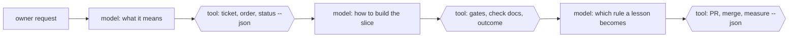

# forger

Deterministic tools and skills that let Claude Code models forge ahead reliably:
an unattended development loop in which a worker builds one ticket at a time, a
supervisor turns the owner's requests into tickets and watches the work land, and
a refinement loop turns every correction and every failure into a better process.

At its core, forger reaches for determinism. Anything that must come out the
same every time is a tested command; models reason only where judgement is
needed, between hard boundaries the tools enforce. See
[`docs/01-principles.md`](docs/01-principles.md), principle 0.

Hexagons are tools: tested commands with machine-readable output that the model
calls and cannot talk its way around. Rectangles are judgement.

The goal is a loop that heals itself, learns and adapts: each lesson climbs from
a note to a rule, a template, a check and finally a tool, until it holds without
anyone remembering it, and the process is measured by commands, not claims.

## The three layers

| Layer | Who runs it | What it does | Where it lives here |
|---|---|---|---|
| **Engine and worker** | a detached runner, headless sessions | picks the next ticket, runs one worker per ticket under a budget, counts outcomes, halts on trouble | `plugins/forger/` |
| **Supervisor** | an interactive session with the owner | intake, ordering, dispatch, watching, verifying, reporting | `docs/04-supervising.md` |
| **Refinement** | the supervisor, within the owner's approval policy | turns corrections, failures and friction into rules, templates, checks and tools | `docs/05-refining-the-process.md` |

## Bring your own skills

Forger depends on no skill collection, and it incorporates any you install. The
points where a model does judgement work (interview, glossary, test-first,
review, diagnosis, merge conflicts) are named **skill slots**. Each has a
built-in forger step, and you map an installed skill onto a slot in the `skills`
section of `.claude/workloop.config.json`. The commands never name a skill: they
ask `skills --json` what each slot resolves to, and fall back to the built-in
step when a slot is unmapped or its skill is missing.

The mattpocock-skills collection is the worked example: a ready-made preset maps
it onto the slots, and `/forger:setup` offers it when the collection is
installed. The slots, the config and the preset are described in
[`plugins/forger/README.md`](plugins/forger/README.md).

## Read in this order

0. [`plugins/forger/README.md`](plugins/forger/README.md) - the plugin: commands, tracker, skill slots, install.
1. [`docs/01-principles.md`](docs/01-principles.md) - the few ideas everything else follows from.
2. [`docs/02-the-loop.md`](docs/02-the-loop.md) - roles, files, states and invariants.
3. [`docs/03-tickets.md`](docs/03-tickets.md) - what a good ticket and a good PR carry.
4. [`docs/04-supervising.md`](docs/04-supervising.md) - the supervisor's playbook, layer by layer.
5. [`docs/05-refining-the-process.md`](docs/05-refining-the-process.md) - how the process improves itself.
6. [`docs/06-failure-catalogue.md`](docs/06-failure-catalogue.md) - failures seen in real runs, their causes and their fixes.
7. [`docs/07-roadmap.md`](docs/07-roadmap.md) - what to build next.

[`GLOSSARY.md`](GLOSSARY.md) holds the vocabulary; [`docs/adr/`](docs/adr/) the
decisions; [`docs/plan-foundation.md`](docs/plan-foundation.md) the plan the
foundation was built from. `plugins/forger/templates/` holds the files a repository adopts: the ticket and PR
shapes, the work order, the report, the retro and the rule record.

## Status

Early. The engine and commands in `plugins/forger/` work and carry the defects
listed in the failure catalogue; the roadmap and the backlog say what is being
built next.

## Licence

MIT. See [`LICENSE`](LICENSE).
