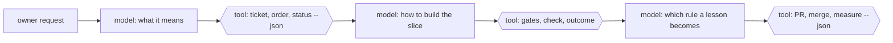

# Principles

Each of these was learned the hard way, usually more than once. The rest of the
process follows from them.

## 0. Determinism first, reasoning between the boundaries

This is the one the others serve. Anything that must come out the same every
time is a deterministic tool: a tested Bun/TypeScript command with a `--json`
output that a model calls and cannot talk its way around. Selecting the next
ticket, counting outcomes, deciding whether a ticket merged, checking the words
in a doc, measuring the process: tools. A model reasons only where judgement is
needed - what a request means, how to build a slice, which rule a lesson becomes
- and always between hard boundaries the tools enforce.

When a model gets something wrong that a tool could have decided, the fix is the
tool, not a better prompt. A rule that matters climbs until it is a tool (see
principle 7). See [ADR 0002](adr/0002-determinism-first.md).

Hexagons are tools: tested commands with machine-readable output that the model
calls and cannot talk its way around. Rectangles are judgement.

## 0a. Any model, any harness

The tools are the contract; the model and the harness that runs it are
adapters. Any model that can run a command and read its JSON can work between
the boundaries, because the decisions are not in the model. A model is chosen
per role for cost and quality - a `fast`, `standard` or `deep` tier, mapped to a
model id in the config - and never because a decision depends on it. Prose
names the role: the worker, the supervisor, the agent adapter. The harness
sits behind the `AgentRunner` interface, so a second one is an adapter, not a
rewrite. `check docs` flags a model or vendor name in prose outside the adapter
docs. See [ADR 0005](adr/0005-any-model-any-harness.md).

## 1. One ticket, one worker, one PR

A worker starts cold, builds one vertical slice, proves it with the gates, opens
one PR and merges it. Small enough to fit one fresh context window; complete
enough to demo or verify on its own. Wide mechanical changes are the exception:
expand, migrate in batches, contract, each its own ticket.

## 2. The repository is the memory

A worker remembers nothing between tickets. Everything it must know lives in
files it reads at the start: the process doc, the backlog, the ticket, the work
order, the code. If the next worker needs to know it, it is written down where
the next worker will read it. A rule that lives only in a supervisor's head, or
in a chat, is lost at the next session.

## 3. Verify, never trust

What a worker says it did, what the engine's log says it is doing, and what
actually happened disagree often enough to matter. The supervisor checks facts:
the checked-out branch, its commits, the PR, CI's own logs, the deploy. "Exited
cleanly" is not "merged", and a quiet loop is not a finished loop.

## 4. Gates, never bypass

Typecheck, lint and tests are green before every commit and every merge. A
failing hook is fixed at its cause, never skipped. What the gates cannot catch is
written down beside them, so a worker knows where its own checking must go
further.

## 5. The owner decides; everyone else recommends

The owner is asked as little as possible and always with a recommendation. Safe
bets are taken and reported, so the owner overturns rather than approves. Things
that are hard to undo (clearing a HALT, resetting counters, data in production,
anything outward-facing) wait for the owner's word, every time.

## 6. Speed the process, never raise the budget

When a run is too long, the answer is a faster process (find knock-on effects
first, sweep a failure once, run only the affected tests), not a bigger time or
money budget. A budget that keeps rising hides a process that keeps slowing.

## 7. Every correction becomes a rule, every rule climbs toward a check

A correction from the owner or a failure in a run is captured once, in the
owner's words, and turned into the cheapest durable form that will actually be
followed. Rules that matter climb a ladder from a remembered note to a written
rule, to a template section, to an automated check. "A missing translation fails
a check, not a person's memory." See `05-refining-the-process.md`.

## 8. Durable docs hold only what stays true

No counts, timings or dated snapshots in a durable doc: they disagree with each
other within months. Point at the command that computes the number instead.
Narrative ("we changed X to Y") belongs in the PR and the commit, not the code or
the process doc.

## 8a. The default stack is Bun and TypeScript

A repository with no source file gets a running Bun and TypeScript skeleton
from `setup`, with gates that run and a journey that passes. A repository that
already has code keeps its own stack and gets no skeleton. Another stack brings
its own skeleton as a starter, chosen by name.

## 9. Data in production is sacred

No resets, no "the old shape is gone". A change to a stored shape carries every
stored record forward. A worker never treats a production system as a scratch
space.

## 10. Plain words

Tickets, PRs and reports are written for a person reading on a phone: short
sentences, the owner's own words quoted, no jargon the reader did not
introduce, ASCII punctuation. No attribution to tools in commits, PRs or issues.
