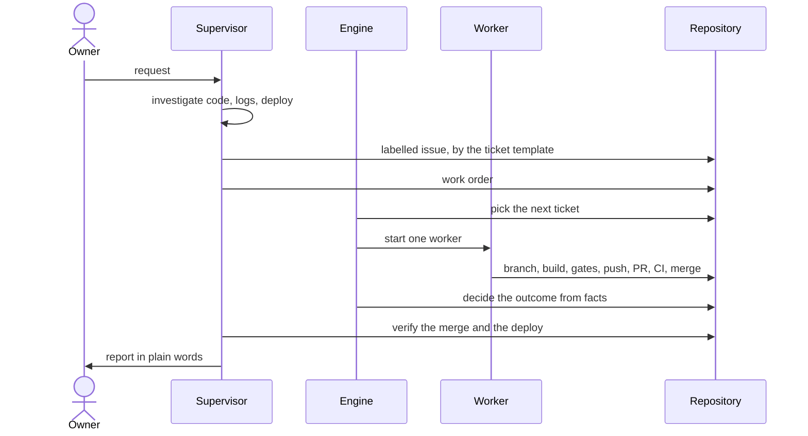
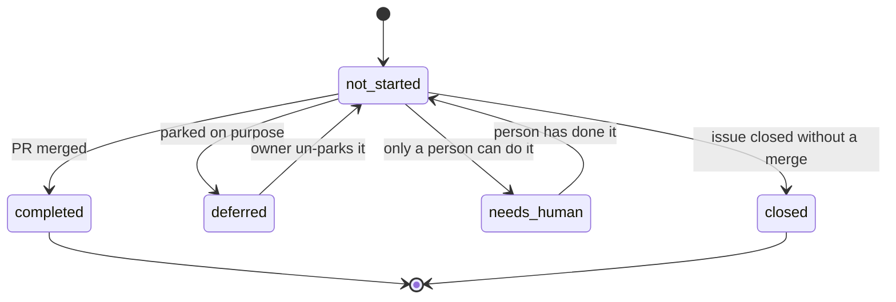
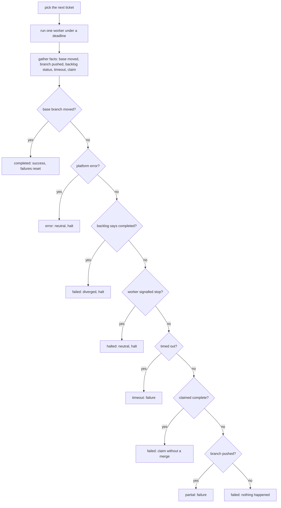

# The loop

## Roles

| Role | Is | Does | Never does |
|---|---|---|---|
| **Owner** | the person the work is for | asks, decides, reviews designs, approves anything hard to undo | needs to babysit a run |
| **Supervisor** | an interactive Claude session with the owner | intake, ordering, dispatch, watching, verifying, reporting, refining the process | implement a ticket, edit product code |
| **Engine** | a detached long-running process | picks the next ticket, starts one worker, enforces the budget, counts outcomes, halts | decide what a ticket means |
| **Worker** | a headless Claude session, one per ticket | reads the ticket and the code, builds, runs the gates, opens and merges the PR | pick a different ticket than the order says, bypass a gate |

The supervisor is a peer of the owner, not a worker. When it feels the urge to
fix code itself, the fix belongs in a ticket.

## Files

All per-repo. The engine is generic; everything project-specific lives in the
consumer repository.

| File | In git | Owner of writes | Purpose |
|---|---|---|---|
| `process.md` | yes | supervisor (by PR), workers (gotchas, by PR) | the per-repo brain: what the repo is, the gates, the rules, what the gates miss, the ticket shape |
| `backlog.json` | yes | supervisor (queueing, by PR), workers (status, in their PR) | the backlog when the tracker is not GitHub; on GitHub the issues are the backlog and a merged PR closing one is its completion |
| `workloop.config.json` | yes | owner | gates command, models and budgets, limits, paths, tracker |
| work order (`inbox/owner-work-order.md`) | no | supervisor | the owner's current priority, read by every worker first |
| `state.json`, `work.log`, `output/` | no | engine | counters, logs, per-iteration output |
| `HALT` | no | engine or worker | stops the loop until a person clears it |
| `runner.lock` | no | engine | the pid of the one live engine; a second `run` refuses, a dead pid is taken over |
| `events.jsonl` | no | engine | append-only terminal events (completed, halted, stalled, timed out, too many failures, engine gone), one JSON line each, for watchers |
| owner notes (`human.md`) | yes | workers and supervisor | what only the owner can do: switches, checks owed, open choices |
| memory notes | no (user profile) | supervisor | durable preferences and lessons, one fact per file |

## The lifecycle of a request

The ticket is queued as the labelled issue on GitHub, else in `backlog.json` by PR.

A spike follows the same path but produces a design (a doc, decision rows,
boards) and build tickets, which wait for the owner's review unless the owner
said to build straight after.

## Ticket statuses

| Status | Meaning |
|---|---|
| `not_started` | the engine may pick it |
| `completed` | merged |
| `deferred` | parked on purpose |
| `needs_human` | only a person can do it; dependents wait |

`closed` exists only with the GitHub tracker: the issue was closed some other
way than by a merged PR, so it is neither done nor work to start.

`completed` must mean merged. A worker that marks a ticket completed before its
PR merges can mislead the engine (see the failure catalogue).

## One engine iteration

The engine does not take the worker's word. It gathers facts about the
repository after the worker ends and `decideOutcome` (a pure function, with a
test per branch) turns them into a status.

A merge is the only progress. Failures count toward a halt; a run that merged
and then timed out is still a success, with a warning.

## Invariants

- One engine at a time, checked before every start.
- One worker per ticket per iteration.
- Gates green before every commit and merge.
- The base branch is protected; every change, the supervisor's included, goes
  through a PR.
- A HALT is cleared only on the owner's word.
- The run budget is not raised; the process is made faster.
