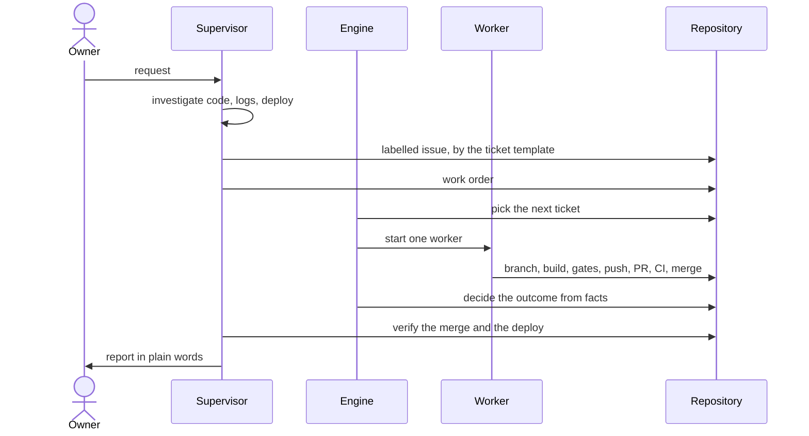
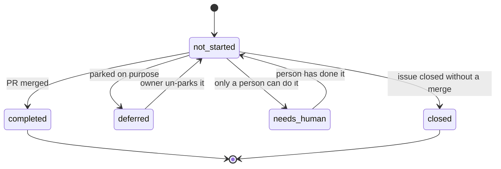
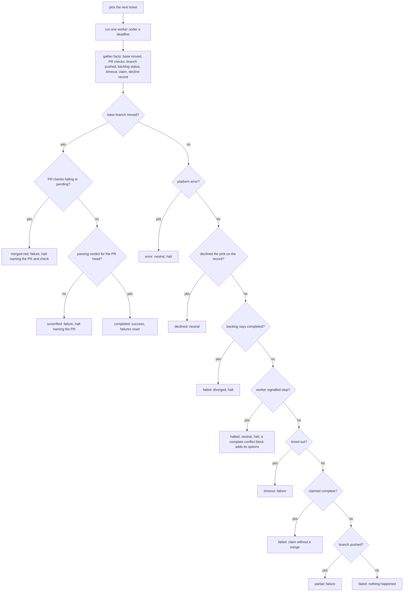

# The loop

## Roles

| Role | Is | Does | Never does |
|---|---|---|---|
| **Owner** | the person the work is for | asks, decides, reviews designs, approves anything hard to undo | needs to babysit a run |
| **Supervisor** | an interactive agent session with the owner | intake, ordering, dispatch, watching, verifying, reporting, refining the process | implement a ticket, edit product code |
| **Engine** | a detached long-running process | picks the next ticket, starts one worker, enforces the budget, counts outcomes, halts | decide what a ticket means |
| **Worker** | a headless agent session, one per ticket | reads the ticket and the code, builds, runs the gates, opens and merges the PR | pick a different ticket than the order says, bypass a gate |

The supervisor is a peer of the owner, not a worker. When it feels the urge to
fix code itself, the fix belongs in a ticket.

## Files

All per-repo. The engine is generic; everything project-specific lives in the
consumer repository.

They live in `.forger/`, a folder forger owns, so any harness can run the loop
without its own settings being mixed with forger's. A repo set up when these
lived in `.claude/` keeps working: each command prints one warning, and
`migrate` moves the files. The harness that runs the worker is an adapter
chosen by the `harness` config key (ADR 0009).

| File | In git | Owner of writes | Purpose |
|---|---|---|---|
| `process.md` | yes | supervisor (by PR), workers (gotchas, by PR) | the per-repo brain: what the repo is, the gates, the rules, what the gates miss, the ticket shape |
| `backlog.json` | yes | supervisor (queueing, by PR), workers (status, in their PR) | the backlog when the tracker is not GitHub; on GitHub the issues are the backlog and a merged PR closing one is its completion |
| `workloop.config.json` | yes | owner | gates command, model roles and budgets, limits, parallelism, paths, tracker |
| work order (`inbox/owner-work-order.md`) | no | supervisor | the owner's current priority, read by every worker first |
| `state.json`, `work.log`, `output/` | no | engine | counters, logs, per-iteration output |
| `HALT` | no | engine or worker | stops the loop until a person clears it |
| `runner.lock` | no | engine | the pid of the one live engine; a second `run` refuses, a dead pid is taken over |
| `declined.json` | no | worker (`decline`), engine | the worker's decline of the pick; the next run of that iteration reads it once and deletes it |
| `worktrees/` | no | `worktree` | one git worktree per ticket, created from the remote base branch and removed after the run |
| `checks.jsonl` | no | `check` | one record per opinion per `check` run inside a worker: ticket, iteration, check, and the count of failed and waived findings; a clean run is one record with no opinion |
| `verdicts/` | no | `verify` | one verdict record per verified PR head commit: a judgement and evidence for each acceptance criterion; a push after it makes it stale |
| `tmp/` | no | `verify`, `critique` | the disposable checkout of a PR's head each makes, removed when it finishes; kept out of the system temp folder, which may be small and shared |
| `events.jsonl` | no | engine | append-only terminal events (completed, halted, stalled, timed out, too many failures, engine gone), one JSON line each, for watchers |
| owner notes (`human.md`) | yes | workers and supervisor | what only the owner can do: switches, checks owed, open choices |
| memory notes | no (user profile) | supervisor | durable preferences and lessons, one fact per file |

## The lifecycle of a request

The ticket is queued as the labelled issue on GitHub, else in `backlog.json` by PR.

A spike follows the same path but produces a design (a doc, decision rows,
boards) and build tickets, which wait for the owner's review unless the owner
said to build straight after.

## Ticket statuses

| Status | Meaning |
|---|---|
| `not_started` | the engine may pick it |
| `completed` | merged |
| `deferred` | parked on purpose |
| `needs_human` | only a person can do it; dependents wait |

`closed` exists only with the GitHub tracker: the issue was closed some other
way than by a merged PR, so it is neither done nor work to start.

`completed` must mean merged. A worker that marks a ticket completed before its
PR merges can mislead the engine (see the failure catalogue).

## Before the first pick

`run` brings the base branch up to date itself. On the base branch, with no other engine holding the lock and no uncommitted change besides the engine's runtime files, it fast-forwards to the remote and, when that changed the plugin it runs from, starts itself again once on the new code. A failed fast-forward stops the start with git's reason; nothing is stashed, reset or discarded, and any other checkout is left as it is.

## One engine iteration

The engine does not take the worker's word. It gathers facts about the
repository after the worker ends and `decideOutcome` (a pure function, with a
test per branch) turns them into a status.

After a merge, a project with the delivery pack gets its own commands run before the next pick (ADR 0022): `deploy` when configured, then `check`, in the main checkout at the merged commit. A pass records `delivered`. A failure records `delivery_failed`, files one `P0` issue with the intake label that links the merged PR and ends with the failing command's output (an open one is commented on instead), and then runs `rollback` when configured, recording `rolled_back` or `rollback_failed`. A failed delivery does not halt and the new issue is a normal pick; a failed rollback halts, since the build is broken with no way back. Delivery never changes whether a merge happens, and without the pack nothing runs.

The engine's pick is the contract, and the worker's prompt names it: the worker builds that ticket or declines it, and is never asked to choose. A run with no workable ticket gets a prompt that says so. A branch for any other ticket is `off-pick`,
a failure, even when its own PR merged: the work is real but is never counted as
the pick's completion. A decline record for the pick, with nothing built, is
`declined`, the one sanctioned exit, and it is made with
`decline --ticket <id> --reason blocked|too-large|unclear --detail <text>`: the
command writes the record and takes the ticket out of the backlog (on GitHub the
intake label becomes `needs-info` and the detail is commented on the issue), so
the same ticket is not picked again. `decline` reads the issue's labels back and exits non-zero, naming the label, when the relabel did not hold; `setup` creates any loop label the repository lacks, and `orient` reports a missing one as an anomaly. A decline counts toward the stall counter,
and `limits.maxConsecutiveDeclines` declines in a row halt the loop with a line
naming each ticket and reason; `report` lists the declined tickets. A record for
a different ticket is a failure. The iteration log header always prints the engine's pick next to the
ticket the run was held to. A timed-out run's log also names the worker's branch, its last commits and the PR with its state, and ends with the worker's output. The full table is in ADR 0008.

A worker's `stop` is a verdict on its one ticket, not on the loop. The engine
labels the issue `needs-human`, posts the reason (or, for a `stop conflict`,
the options), records a `set_aside` event and picks again. The next pick also
skips every ticket that shares a footprint with one set aside in this run.
`limits.maxSetAside` tickets set aside in a row, with no merge between them,
halt the loop, since the cause is then unlikely to be the tickets. An
infrastructure error, a merge on red checks, an unverified merge, a backlog
entry that reads completed with nothing merged, too many failures in a row and
a stall still halt, because none of those belongs to one ticket
([ADR 0020](adr/0020-a-stop-that-belongs-to-one-ticket-sets-the-ticket-aside.md)).

A green merge is the only progress. Failures count toward a halt; a run that
merged and then timed out is still a success, with a warning. A merge made on
red or unfinished checks is never a success: the worker merges through
`merge --pr <n>`, which waits for CI and refuses red, and a merge that got past
it halts the loop.

## The hook layer

Three layers hold a worker to its boundaries, earliest first: a harness hook
refuses the call before it runs, the engine reads the facts after the run, and
GitHub's branch protection refuses a merge without the `forger/verify` status.
The hook is the one that stops a mistake before it lands.

`setup` installs `work hook` as a PreToolUse hook in the harness's project
settings (`.claude/settings.json` for the default harness, which every worktree
checks out with the code). The command it writes names `$FORGER_PLUGIN_ROOT`, which the engine exports to the worker,
so the committed file holds no machine path. The engine names the worker's role, ticket and iteration in
the worker's environment; the hook reads them and judges each shell and edit
call against `.forger/hooks.json`. The decision is a pure function of the
policy and the call, and it reads through chains (`&&`, `;`, pipes), wrappers
(`env`, `sudo`, `bash -c`, `eval`) and subshells. The default rules:

- `merge`: `gh pr merge`, and the merge endpoint or mutation reached through
  `gh api` or curl. The worker merges only through `work merge --pr <n>`.
- `push-base`: a push to the base branch (`HEAD:main`, `--delete main`,
  `--all`, `--mirror`, a bare push while on it) and a forced push (`-f`,
  `--force`, a `+` refspec). `--force-with-lease` to the worker's own branch is
  allowed, since a rebased branch needs it.
- `status-write`: writing commit statuses or check runs, so only the engine sets
  `forger/verify`.
- `state-edit`: editing or removing the engine's state under `.forger/` (state,
  events, verdicts, checks, HALT, lock, lease), by an editor tool or a shell write.
- `leave-worktree`: for a worker the engine started in a worktree of its own
  (the engine names it in the worker's environment), an editor tool call, a
  `cd` or a shell write on a path in the loop's checkout outside that
  worktree. Another worker's worktree counts as outside. Reading the loop's
  checkout by path, and running the engine from it, stay allowed.

A refusal tells the worker what to do instead, and is appended to the event
file as `worker_denied`, with the ticket, the rule and the refused command. A
project adds rules of its own in `deny` (an id, a regular expression over each
simple command, and the message). The defaults ship on: a policy may drop one,
but `check hooks` fails until a waiver on `base.worker-hooks` records who
approved it, and it fails too when the harness's settings do not run the hook.

`verify` and `merge` look at the engine they were loaded from before anything else. When its source is in a git
work tree and has an uncommitted change (a changed tracked file, or a new file git does not ignore), they look again every few seconds while it has
one, up to `limits.engineChangedWaitSeconds`, and go on as if they had found none when the changes go within the wait.
When the changes outlast it they refuse with
exit 1: no verdict, no status, no merge, and an `engine_changed` event naming the paths. A verdict or a merge from a
changed engine does not count. The cause is the engine's checkout, not the ticket: an iteration whose ticket has an `engine_changed` event halts the
loop with the command and the paths in the reason, counts no failure, stall or decline, sets no ticket aside and drops
any decline the worker recorded. The ticket keeps its label and its open PR, and the run after the resume picks it
again. An engine outside a git work tree, as an installed plugin is, is not checked.

The same hook guards the supervisor: a call made without the worker role,
while an engine holds the lock, may not run a state-changing git command
(`checkout`, `switch`, `reset`, `stash`, `pull`, `merge`, `commit`, `rebase`
and the like) in the loop's checkout. Read-only git, and a worktree's own
checkout, are allowed.

## Verifying a PR

`verify --pr <n> --json` runs an independent check of a PR against its ticket
(ADR 0010). It builds the verifier's input from the ticket's acceptance
criteria, the diff against the base and the gate result for the PR head, and
nothing else: never the worker's transcript, the PR body or the commit
messages. The verifier runs through the same agent seam as a worker, in a
writable, throwaway copy of the head, on the `verifier` tier of the config.
Before the model starts, the engine installs dependencies in that copy: the
`verify.setup` command if the config has one, otherwise the install step of
`gates`, otherwise the frozen install for the lockfile at the root of the copy; an
empty `verify.setup` turns setup off, and the verdict record names the command that ran
and where it came from. When none of the three gives a command, no setup
runs: the prompt says the copy has no dependencies, and `verify` warns on stderr.
The model can then run the tests and the gates itself. A setup that
fails is reported as an infrastructure error and records no verdict, so it is
never mistaken for `cannot_tell` on a criterion. The engine never pushes or
changes the PR from the verifier, and the copy is removed afterwards. That tier
defaults to one other than the default worker tier where `model_by_priority`
has one, so the verifier does not share the worker's blind spots.

The criterion "Gates green" is not put to the model. The engine decides it from
the CI checks on the head, leaving out `forger/verify`, the verdict's own
status: every check successful is `met` with `ci` evidence naming the checks, a
failure is `not_met` naming the failing checks, and checks still running are
waited for up to `--timeout` before the criterion is `cannot_tell` with
`missing: pending`. Trailing words such as "including the e2e job" name checks
that must be among the successes. A repository with no CI runs the configured
`gates` command in the verifier's copy and decides from its exit code. The
verifier's input lists the criterion as decided by the engine.

A failed check is run once more on the same head, with no change, to name the
cause. The engine starts the failed jobs again, waits as it waits for pending
checks and decides from the result. A pass is a flaky gate: the criterion is
`met` by the passing run, a `flaky_gate` event names the check and the failed
tests the job's log names, and one ticket is filed to make the test
deterministic (a later sighting of the same check comments on the open ticket).
A second failure, a rerun that cannot be started, or a head whose failed check
was already rerun leaves the criterion `not_met`. A red check is never waved
through, and a repository with no CI reruns a failing `gates` command once in
the verifier's copy under the same rules.

When the PR changes images under `docs/screenshots/`, the verifier opens each
one and checks it against the ticket's "UI states" section and any criterion
about what is visible. Each state is an entry in the verdict, judged from the
image and cited as evidence of kind `screenshot`. A state the ticket names while
the PR changes no screenshot is recorded `cannot_tell` without asking the
verifier, and a `met` on a state with no resolving screenshot is demoted to
`cannot_tell`, so a defect the image shows (a banner with no filter active) is
`not_met` and blocks the merge.

The engine does not take a `met` on the verifier's word. The verifier runs the
commands it cites through `run-logged`, which appends each command with its exit
code and output to a log the engine owns. It clears the variables under which a
test tool prints failures only, so a passed test shows in the log. Output past the log's limit is cut, but every test result line is kept and the record says `truncated`; a demoted test citation says so when a record was cut. Every
citation is then checked against what the engine recorded in the copy: a `file`
exists and the line is within it, a `test` appears in a recorded run and passed
(cited as the run reported it, or as `describe > test` with the enclosing
describes in order and the last part the test's own name), a `command` is in the
log with exit 0 (matched on the folder it ran in and its shell words, so a leading
`cd <folder> &&`, a `sh -c` or `bash -c` wrapper and the style of quoting do not
matter; `run-logged` records the folder relative to the copy), a `screenshot` exists under `docs/screenshots/`. A `met` with a
citation that does not check out becomes `cannot_tell`, and the verifier is asked
once more about those criteria with the failed citations named. Every
`cannot_tell` carries `missing`, one of `no_state`, `no_test`, `no_data`,
`infra`, `ambiguous_criterion` (the engine itself also uses `pending`); an answer without it is rejected. The handover
comment and the supervisor report name it, so the owner sees what to supply.

The output is validated by the verdict validator. Valid output is recorded as
judged, an unconfirmed `met` demoted to `cannot_tell`; output that cannot be
read, or breaks the validator's rules, is recorded `cannot_tell` for every
criterion. The record sits in `verdicts/` keyed by the PR and its head commit,
so a later push leaves it stale. The command exits 1 unless every criterion is met.

On a GitHub tracker `verify` also publishes the verdict as the commit status
`forger/verify` on the PR head: `success` for a pass, `failure` for a block or
an unclear verdict, with the decision as its description. The verifier's own
gate input leaves that status out, so it never judges its previous verdict. A
status is bound to the commit, so a push after a pass leaves the new head
without one until `verify` runs again. `setup` adds `forger/verify` to the base
branch's required checks: a branch with other required checks keeps them, and an
unprotected one gets a protection that requires only this check and applies to
administrators, since a worker usually holds the owner's token. GitHub then
refuses a merge that skipped `verify`, rather than the engine finding it after
the code reached the base branch. When the token cannot change the protection,
`setup` says so and the owner adds the check by hand; `orient` reports a base
branch that does not require it.

## Skill slots in the loop

Each point of judgement is a skill slot with a built-in step (`skills --json`
lists them, [`reference/skill-slots.md`](reference/skill-slots.md) tabulates them). Beyond building a ticket, three
slots cover the stages around it, each with a named output:

- `risk` (output `risk_report`) runs after the review and before the verifier.
  Its findings go to the worker; the verifier stays the merge gate.
- `pr_body` (output `pr_body`) writes the PR body. `pr-body` then checks that
  `Closes #<n>` and the ticket's review sections survived, whatever the skill wrote.
- `retro` (output `retro_proposals`) is used by the `retro` command.

An unmapped slot runs its built-in step, so nothing changes until a project maps one.
For `test_first`, `review` and `diagnose` that step is a skill file forger ships
(steps, red flags, exit criteria, then the slot's contract); the one-line step
runs only if the file is missing.

## The stages as data

The order of the stages, the slots each runs and the gate after each is a
definition (`plugins/forger/pipeline/default.json`), not prose in the command
files. `pipeline --json` resolves it for one ticket: a slot with a `when` runs
only for the tickets whose labels and knock-on paths match, a slot with an `on`
runs only when that event happens in the stage (a red gate, a conflicting
rebase), and each slot reports the skill, file or built-in step chosen and the
reason. A project's `.forger/pipeline.json` overlay can disable a stage, add a
slot or replace a gate; it cannot reorder. The design is ADR 0016.

The commands read their stage's slots from `pipeline --json --stage <id>` and
keep only their judgement prose. `check docs` fails a shipped command file that
names a slot none of its stages has, so the prose and the definition cannot
drift. With no mapping and no overlay every slot resolves to its built-in step,
as before.

### The plan a run kept

The plan resolved for the ticket is stored with the run: in the in-flight run of
the state (shown by `status --json`) and as a `plan:` line of the iteration log,
which `measure` reads back per ticket. A run stored before plans were kept has
none and reads as it always did.

### Output contracts

Each slot's result has a contract, and `contract --slot <slot> --file <path>`
checks it with a pure validator over the parsed result plus facts the command
gathers (the diff's paths, the ticket's criteria, the gates command). A result
that fails is handled by a fixed policy, not by the worker's judgement: retry the
same skill once with the problems shown, then the built-in step, then a decline
with reason `unclear`. Each attempt is a `contract_attempt` event.

## Bounding the verify loop

`handover --pr <n> --json` reads the PR's verdict records and says the next move.
A round is one record. A passing latest record means merge. Otherwise the worker
fixes and verifies again while rounds remain (`limits.maxVerifyRounds`). Once they
are spent the command labels the issue `needs-human`, takes it out of the backlog,
comments each unmet or unclear criterion, and exits 1; the run ends as a recorded
failure. A criterion judged `cannot_tell` in more than one round is called out in
the comment as one to reword or make mechanical. `handover --list` reports the
tickets handed over, with the criteria at fault.

## Where a worker puts code

A worker reads `## Structure` in the project's process file before it adds a file: it finds the feature folder, creates one when there is none, never grows a folder `check structure` reports over its limit or frozen, and runs `check structure` before it commits. A new finding is fixed by moving the file, not by waiving it; only the owner waives. The plan command writes the section on a repo that has none.

## Probes before a worker

A ticket may carry a `## Probe` section (see `docs/03-tickets.md`). The engine
runs its commands before it spends a worker; a failed probe labels the issue
`needs-human`, comments the expected and actual result and moves to the next
ticket, without counting as a failure. `docs/reference/engine.md` has the detail.

## Who merges a ticket

A ticket's `## Merge` section says `when green` (the default) or `owner reviews`.
An `owner reviews` ticket is built, gated and verified on the criteria machines
can check, and its PR is opened but not merged: `merge` refuses it. The engine
labels the PR and the issue `owner-review`, records an `owner_review` event and
picks the next ticket, so the loop does not halt on a judgement only the owner
can make. A ticket blocked by it stays blocked until the PR merges. When the
owner merges, the issue closes and the engine counts the ticket completed on a
later iteration.

## A worktree per worker

For workers that run side by side (ADR 0011) each ticket gets its own git
worktree and branch, so no worker moves the main checkout.
`worktree --ticket <id> --json` fetches the base branch, creates
`feat/<id>` from the remote base in a worktree beside the engine's state, and
prints its path; `worktree --ticket <id> --remove` removes the tree and keeps
the branch. `rebase --ticket <id> --json` fetches the base and rebases the
branch inside its worktree, and reports `clean`, `conflict` (with the files; the
rebase is left in progress there for the worker to resolve and continue) or
`error`. Both exit 1 unless they succeeded. The git calls sit behind the
injected command port, so the decisions are tested with a fake one.

## Running workers side by side

`parallelism` in the workloop config is the number of workers the loop runs at
once. It defaults to 1, which is the single-worker loop in the main checkout,
unchanged. It must be a positive integer; zero, a fraction or a string is
refused when the config is read.

Above 1 the supervisor keeps one lock, one HALT and one state, and starts
workers with the scheduling rule: the candidates in the engine's order, each
taken only if it may run together with every running ticket (a ticket declared
`serial`, an unknown footprint, a shared path or folder, or a dependency keep
it waiting). Each worker builds in its own worktree and branch, is told to stay
current with `rebase --ticket`, and keeps its own timeout.

Facts are read per worker, from its worktree. With others merging, base moving
is no evidence of this run's merge, so only the worker's own PR can say it
merged. If the branch is pushed and unmerged when the worker ends, the engine
rebases it once more: a branch that still conflicts ends the run as `conflict`.
That is a failure that counts once, never a halt; the branch is dropped locally
and on the remote, the ticket stays open, and a later run takes it again.

A HALT stops new starts. Workers still running get `limits.killGraceSeconds`,
then their process groups are ended. Infrastructure errors trip HALT as before.

## State on a branch and the lease

With `state.home` set to `branch` the state record, the event log and a lease
live on the state branch of the remote (ADR 0015), and `status`, `orient` and
`measure` read them from there. Before anything else `run` claims the lease. If
another engine holds a live lease, the run refuses and starts nothing. The
holder renews it at the top of every iteration and on a timer inside a long
one, and releases it when the loop ends. A lease nobody renews expires after its
TTL; the next engine takes it over and records a `lease_takeover` event naming
the previous holder. An engine that cannot renew, because the branch could not be
written or another engine took over, stops starting work, and leaves HALT alone,
since the loop itself is not at fault.

The same setting serves a CI job: check out the repository, set `state.home` to
`branch`, and run. The lease is the guard between runs on different machines;
a CI concurrency group stays useful as a cheap first filter.

## Invariants

- One engine at a time, checked before every start (the lease across machines, the lock on one).
- One worker per ticket per iteration.
- Gates green before every commit and merge.
- The base branch is protected; every change, the supervisor's included, goes
  through a PR.
- A HALT is cleared only on the owner's word.
- The run budget is not raised; the process is made faster.
