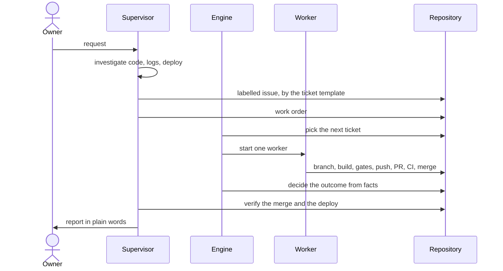
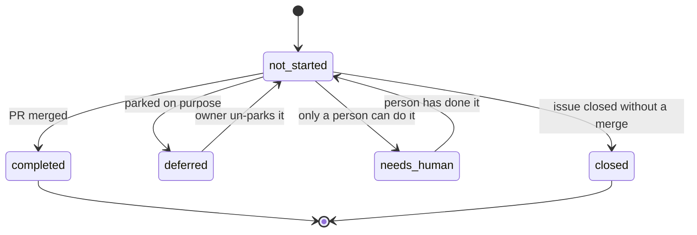
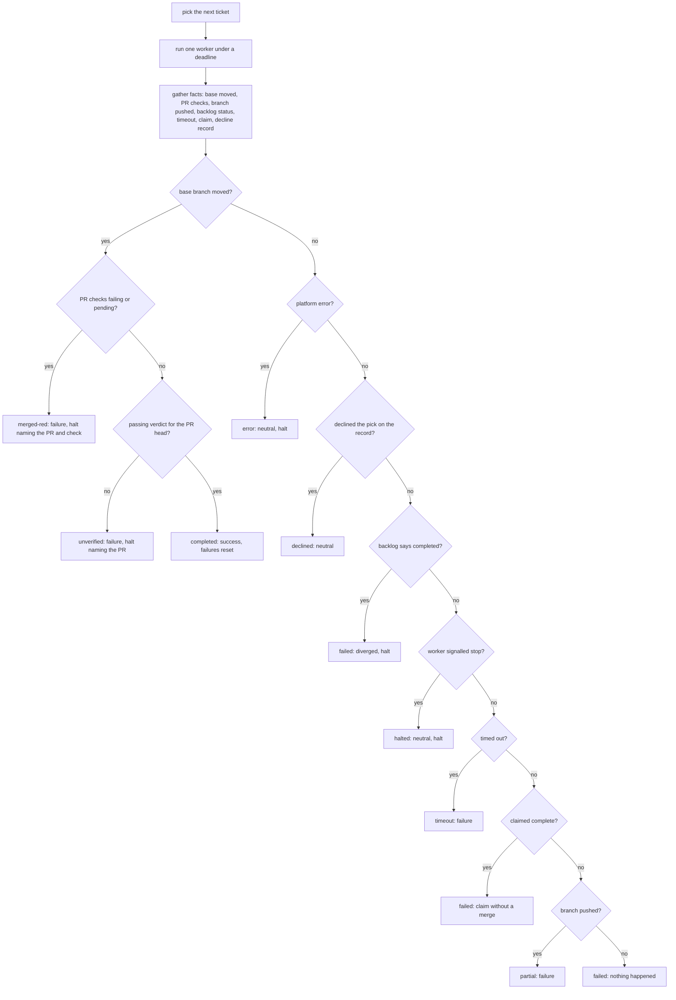

# The loop

## Roles

| Role | Is | Does | Never does |
|---|---|---|---|
| **Owner** | the person the work is for | asks, decides, reviews designs, approves anything hard to undo | needs to babysit a run |
| **Supervisor** | an interactive agent session with the owner | intake, ordering, dispatch, watching, verifying, reporting, refining the process | implement a ticket, edit product code |
| **Engine** | a detached long-running process | picks the next ticket, starts one worker, enforces the budget, counts outcomes, halts | decide what a ticket means |
| **Worker** | a headless agent session, one per ticket | reads the ticket and the code, builds, runs the gates, opens and merges the PR | pick a different ticket than the order says, bypass a gate |

The supervisor is a peer of the owner, not a worker. When it feels the urge to
fix code itself, the fix belongs in a ticket.

## Files

All per-repo. The engine is generic; everything project-specific lives in the
consumer repository.

They live in `.forger/`, a folder forger owns, so any harness can run the loop
without its own settings being mixed with forger's. A repo set up when these
lived in `.claude/` keeps working: each command prints one warning, and
`migrate` moves the files. The harness that runs the worker is an adapter
chosen by the `harness` config key (ADR 0009).

| File | In git | Owner of writes | Purpose |
|---|---|---|---|
| `process.md` | yes | supervisor (by PR), workers (gotchas, by PR) | the per-repo brain: what the repo is, the gates, the rules, what the gates miss, the ticket shape |
| `backlog.json` | yes | supervisor (queueing, by PR), workers (status, in their PR) | the backlog when the tracker is not GitHub; on GitHub the issues are the backlog and a merged PR closing one is its completion |
| `workloop.config.json` | yes | owner | gates command, model roles and budgets, limits, parallelism, paths, tracker |
| work order (`inbox/owner-work-order.md`) | no | supervisor | the owner's current priority, read by every worker first |
| `state.json`, `work.log`, `output/` | no | engine | counters, logs, per-iteration output |
| `HALT` | no | engine or worker | stops the loop until a person clears it |
| `runner.lock` | no | engine | the pid of the one live engine; a second `run` refuses, a dead pid is taken over |
| `declined.json` | no | worker (`decline`), engine | the worker's decline of the pick; the next run of that iteration reads it once and deletes it |
| `worktrees/` | no | `worktree` | one git worktree per ticket, created from the remote base branch and removed after the run |
| `verdicts/` | no | `verify` | one verdict record per verified PR head commit: a judgement and evidence for each acceptance criterion; a push after it makes it stale |
| `events.jsonl` | no | engine | append-only terminal events (completed, halted, stalled, timed out, too many failures, engine gone), one JSON line each, for watchers |
| owner notes (`human.md`) | yes | workers and supervisor | what only the owner can do: switches, checks owed, open choices |
| memory notes | no (user profile) | supervisor | durable preferences and lessons, one fact per file |

## The lifecycle of a request

The ticket is queued as the labelled issue on GitHub, else in `backlog.json` by PR.

A spike follows the same path but produces a design (a doc, decision rows,
boards) and build tickets, which wait for the owner's review unless the owner
said to build straight after.

## Ticket statuses

| Status | Meaning |
|---|---|
| `not_started` | the engine may pick it |
| `completed` | merged |
| `deferred` | parked on purpose |
| `needs_human` | only a person can do it; dependents wait |

`closed` exists only with the GitHub tracker: the issue was closed some other
way than by a merged PR, so it is neither done nor work to start.

`completed` must mean merged. A worker that marks a ticket completed before its
PR merges can mislead the engine (see the failure catalogue).

## One engine iteration

The engine does not take the worker's word. It gathers facts about the
repository after the worker ends and `decideOutcome` (a pure function, with a
test per branch) turns them into a status.

The engine's pick is the contract, and the worker's prompt names it: the worker builds that ticket or declines it, and is never asked to choose. A run with no workable ticket gets a prompt that says so. A branch for any other ticket is `off-pick`,
a failure, even when its own PR merged: the work is real but is never counted as
the pick's completion. A decline record for the pick, with nothing built, is
`declined`, the one sanctioned exit, and it is made with
`decline --ticket <id> --reason blocked|too-large|unclear --detail <text>`: the
command writes the record and takes the ticket out of the backlog (on GitHub the
intake label becomes `needs-info` and the detail is commented on the issue), so
the same ticket is not picked again. `decline` reads the issue's labels back and exits non-zero, naming the label, when the relabel did not hold; `setup` creates any loop label the repository lacks, and `orient` reports a missing one as an anomaly. A decline counts toward the stall counter,
and `limits.maxConsecutiveDeclines` declines in a row halt the loop with a line
naming each ticket and reason; `report` lists the declined tickets. A record for
a different ticket is a failure. The iteration log header always prints the engine's pick next to the
ticket the run was held to. The full table is in ADR 0008.

A green merge is the only progress. Failures count toward a halt; a run that
merged and then timed out is still a success, with a warning. A merge made on
red or unfinished checks is never a success: the worker merges through
`merge --pr <n>`, which waits for CI and refuses red, and a merge that got past
it halts the loop.

## Verifying a PR

`verify --pr <n> --json` runs an independent check of a PR against its ticket
(ADR 0010). It builds the verifier's input from the ticket's acceptance
criteria, the diff against the base and the gate result for the PR head, and
nothing else: never the worker's transcript, the PR body or the commit
messages. The verifier runs through the same agent seam as a worker, in a
read-only checkout of the head, on the `verifier` tier of the config. That tier
defaults to one other than the default worker tier where `model_by_priority`
has one, so the verifier does not share the worker's blind spots.

The output is validated by the verdict validator. Valid output is recorded as
judged, an unresolvable `met` demoted to `cannot_tell`; output that cannot be
read, or breaks the validator's rules, is recorded `cannot_tell` for every
criterion. The record sits in `verdicts/` keyed by the PR and its head commit,
so a later push leaves it stale. The command exits 1 unless every criterion is met.

## Bounding the verify loop

`handover --pr <n> --json` reads the PR's verdict records and says the next move.
A round is one record. A passing latest record means merge. Otherwise the worker
fixes and verifies again while rounds remain (`limits.maxVerifyRounds`). Once they
are spent the command labels the issue `needs-human`, takes it out of the backlog,
comments each unmet or unclear criterion, and exits 1; the run ends as a recorded
failure. A criterion judged `cannot_tell` in more than one round is called out in
the comment as one to reword or make mechanical. `handover --list` reports the
tickets handed over, with the criteria at fault.

## A worktree per worker

For workers that run side by side (ADR 0011) each ticket gets its own git
worktree and branch, so no worker moves the main checkout.
`worktree --ticket <id> --json` fetches the base branch, creates
`feat/<id>` from the remote base in a worktree beside the engine's state, and
prints its path; `worktree --ticket <id> --remove` removes the tree and keeps
the branch. `rebase --ticket <id> --json` fetches the base and rebases the
branch inside its worktree, and reports `clean`, `conflict` (with the files; the
rebase is left in progress there for the worker to resolve and continue) or
`error`. Both exit 1 unless they succeeded. The git calls sit behind the
injected command port, so the decisions are tested with a fake one.

## Running workers side by side

`parallelism` in the workloop config is the number of workers the loop runs at
once. It defaults to 1, which is the single-worker loop in the main checkout,
unchanged. It must be a positive integer; zero, a fraction or a string is
refused when the config is read.

Above 1 the supervisor keeps one lock, one HALT and one state, and starts
workers with the scheduling rule: the candidates in the engine's order, each
taken only if it may run together with every running ticket (a ticket declared
`serial`, an unknown footprint, a shared path or folder, or a dependency keep
it waiting). Each worker builds in its own worktree and branch, is told to stay
current with `rebase --ticket`, and keeps its own timeout.

Facts are read per worker, from its worktree. With others merging, base moving
is no evidence of this run's merge, so only the worker's own PR can say it
merged. If the branch is pushed and unmerged when the worker ends, the engine
rebases it once more: a branch that still conflicts ends the run as `conflict`.
That is a failure that counts once, never a halt; the branch is dropped locally
and on the remote, the ticket stays open, and a later run takes it again.

A HALT stops new starts. Workers still running get `limits.killGraceSeconds`,
then their process groups are ended. Infrastructure errors trip HALT as before.

## Invariants

- One engine at a time, checked before every start.
- One worker per ticket per iteration.
- Gates green before every commit and merge.
- The base branch is protected; every change, the supervisor's included, goes
  through a PR.
- A HALT is cleared only on the owner's word.
- The run budget is not raised; the process is made faster.
