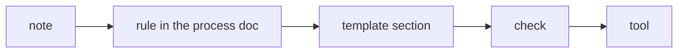
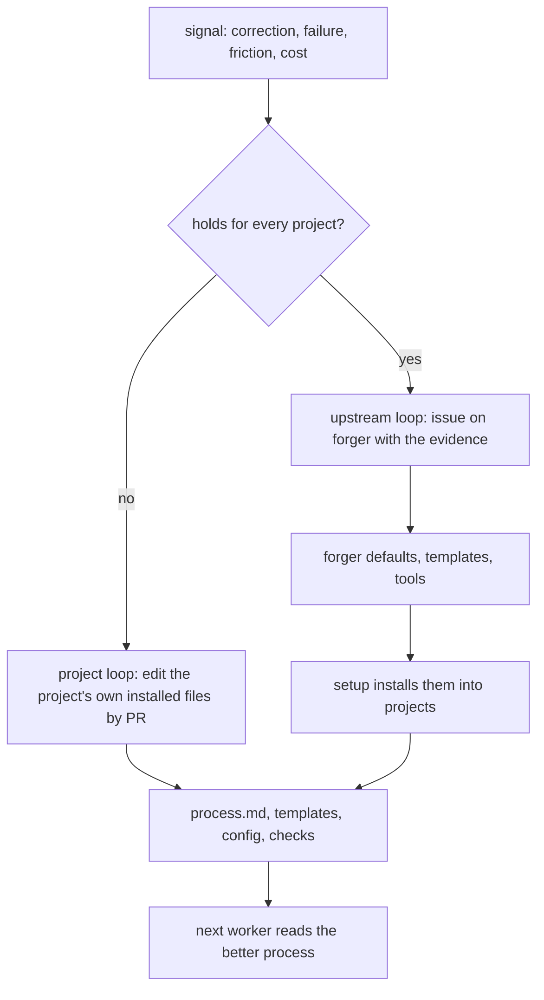

# Refining the process

The loop is only as good as the process the workers read. That process is not
designed up front; it is grown, one correction and one failure at a time. This
document is the process for growing it.

## The signals

Refinement starts from one of five signals. Each is captured the moment it
happens, not at the end of a session.

| Signal | Example | Captured as |
|---|---|---|
| **An owner correction** | "An upgrade should only be added to a record if it was paid for at the time" | the owner's words, dated, verbatim |
| **An owner standing rule** | "Make sure every ticket includes instructions to update docs, examples, help, in every language" | the owner's words, dated, verbatim |
| **A failure in a run** | a worker hung for 37 hours on a wait that matched itself | a timeline from the transcript and the logs |
| **Repeated friction** | the same CI failure found one run at a time, three tickets in a row | the tickets and runs where it recurred |
| **Cost** | a run that took twice its budget; a flaky test retried across many runs | the measurement and the command that produced it |

A signal the owner gives in passing ("good work", "that was too wordy") counts:
confirmed approaches are as worth keeping as corrections, or the process drifts
away from what already works.

## The ladder

Every captured signal becomes the cheapest durable form that will actually be
followed. Forms, from weakest to strongest:

1. **A memory note.** One fact per file, with the owner's words, why it matters
   and how to apply it. Read by the supervisor at the start of every session.
   Cheap, but only the supervisor reads it.
2. **A rule in the process doc.** Read by every worker at the start of every
   ticket. The right home for anything a worker must do differently.
3. **A section in the ticket or PR template.** Makes the rule impossible to
   forget when writing a ticket: an empty section is visible. ("Languages: none"
   is a decision; a missing "Languages" section is a gap.)
4. **A check.** A test, a lint rule, a script in the gates or CI. The rule now
   holds whether or not anyone remembers it. "A missing translation fails a
   check, not a person's memory."
5. **An engine or skill change.** For failures of the loop itself: timeouts,
   counting, process handling. Filed against the engine, with the evidence.

Climb only as far as the rule needs. A one-off opinion stays a note. A rule
every worker needs goes in the process doc. A rule that has been broken once
after being written down earns a template section or a check.

### Worked example: languages

- The owner: "new features and updates require a language review."
  -> a memory note, and a process ticket.
- The process ticket added a "Languages" section to the process doc and the
  ticket template.
- The owner later: human review is a nice-to-have, never a gate.
  -> the rule changed in one place, the decision recorded with its number.
- Messages missing in a language now fail the message parity check, and help
  articles out of date fail `help:stale`. The rule no longer depends on anyone.
- The owner later: "every ticket includes instructions to update docs, examples,
  help content, in every language."
  -> a new ticket section, written into the process doc and the tracker guide
  in one supervisor PR, applied at once to the open tickets, and recorded in
  memory.

### Worked example: a run that timed out after merging

- Signal: a worker merged its PR and was killed ten minutes later while writing
  its summary; the engine counted a failure.
- Timeline from the transcript: where the time went, phase by phase.
- Two forms: a process rule ("push the moment the gates are green, before
  anything slow") and an engine change (count a timed-out run by its outcome).

## Two loops

A lesson lands in one of two places, and the difference is who else needs it.

A project refines the files that setup installed into it and owns them from then
on. A lesson that is true everywhere is filed against forger, so every project
gets it at the next setup or update.

## The steps

1. **Capture** the signal verbatim, with the date and its source.
2. **Find the cause.** For a failure, build a timeline from the worker's session
   transcript (time per tool and phase) and from CI's logs. For friction, list
   every place it recurred. Do not stop at the first plausible cause; the
   37-hour hang looked like a worker bug and was an engine bug underneath.
3. **Choose the form** on the ladder.
4. **Check for an existing rule** that covers it. Update that rule rather than
   adding a second; delete rules that turned out wrong.
5. **Write it** where its readers will read it, in the owner's terms. Say why,
   so a future reader can judge edge cases instead of following blindly.
6. **Apply it now** to the open work it affects (reword open tickets, widen a
   ticket), not only to future work.
7. **Land it through the same gate as code:** a PR, reviewed or at least
   visible, so the history of the process is in git.
8. **Tell the owner** in one line what changed and where.
9. **Update the failure catalogue.** A new failure gets an issue, then an Open
   row linking it in [the failure catalogue](06-failure-catalogue.md). A failure
   seen again gets its new open issue added to its Fixed row. `work catalogue
   --update` moves a row to Fixed once every issue in it is closed by a merged
   PR, and back to Open when one is open. Rows stay. The PR that fixes a
   failure moves its row to Fixed itself, so main never holds a stale row;
   this holds for a row the PR adds for its own issue too.

## Hygiene

Rules accrete. Without care the process doc becomes a pile of gotchas no worker
can hold in mind.

- **One rule, one place.** Other places point to it.
- **Latest decision wins.** Decisions get numbers in a decision log; a rule cites
  the number, so a later decision visibly supersedes it.
- **No transient specifics.** No counts, sizes, timings or dates in a rule; point
  at the command that computes them.
- **Gotchas are debt.** A gotcha in the process doc is a check that has not been
  written yet. Periodically turn the most-hit gotchas into checks and delete the
  prose.
- **Prune.** A rule that no worker has needed in a long time, or that a check now
  enforces, is removed.
- **Memory is not the repo.** A memory note never holds what the code or git
  already records. Notes naming files or flags are verified before they are
  relied on.

## Evals as evidence

A change that swaps the skill behind a slot, or edits a built-in skill, is
backed by `eval --slot <slot> --skill <name>`: the same fixed cases, scored by
the slot's contract validator and the case's properties. Run it for the old and
the new skill and cite the two reports in the proposal. A case a skill misses
that a real run exposed becomes a new fixture under `plugins/forger/evals/`, so
the lesson is a test of the skill rather than a sentence in a prompt.

## Measuring the process

The process is working when, over time:

- fewer runs time out or fail, and a failure leaves enough behind to diagnose;
- a ticket needs fewer CI rounds before it merges;
- the owner corrects the same thing less often;
- fewer runs build something other than the engine's pick, and fewer picks are
  declined;
- the per-ticket cost and time fall without the budget rising.

Each of these comes from a command over the engine's state, the logs and CI, not
from a number written in a doc. `measure --json` reports runs and failures by
cause, the share of runs that were off-pick or declined, how often the verifier
blocked a PR and how often a PR it passed later failed, the terminal events,
and the time, budget cap (`budget_cap_usd`), cost (`cost_usd`) and CI rounds per ticket
(a `feat/issue-<n>` branch attaches to ticket `issue-<n>`),
over all runs or the last N. It also reports the merged tickets, the tickets
that had to be redone and the events that stop the loop until a person acts.
The cost is what the ticket's sessions spent: the work log names each worker's
session id, the harness's transcript for that session holds the token usage per
message, and a price table kept as data turns it into dollars. A project
overrides or extends the default prices in `.forger/prices.json`, keyed by model
name (a key matches any model id that contains it), each entry giving `input`,
`output`, `cache_read` and `cache_write` in dollars per million tokens. A ticket
whose session has no transcript, or whose model has no price, reports `cost_usd`
as null: unknown, never zero and never the cap.

The event log (`events.jsonl`) also records what the owner-intervention and
pick-versus-built measures need: the engine's pick (`picked`, with the ticket),
an approval asked (`approval_asked`, with the action and who may do it) and a
halt a person cleared (`halt_cleared`, with the halt's reason) and a lease taken over from an engine that stopped renewing (`lease_takeover`, with the previous holder) and each attempt at a slot's output contract (`contract_attempt`, with the slot, the attempt and the problems). They share the
file with the terminal events but `events` and `await-event` skip them, so a
watcher wakes only on a terminal event or a mid-run `worker_denied` (a call the
worker's hook refused, with the rule and the command).

`measure` also reports rework and escaped defects per merged PR (ADR 0013), read
from the tracker and git history. A PR is reworked when a later merge within a
window of merges (`--window N`, default the five after it) deletes or replaces
lines it added, or is a revert that names it. Context lines around a change,
docs, lockfiles and the loop's own bookkeeping files do not count, and neither
does a later PR that names the earlier one or its issue, which builds on it on
purpose. An escaped defect is a `bug` issue that
names a merged PR. A pick-versus-built mismatch is a `picked` event whose ticket
differs from the issue the iteration's PR closed. When the tracker cannot be
read the section reports unknown rather than zero.

`measure --opinions` reads the records `check` leaves in a worker and reports,
for each installed opinion that has a check, the runs that failed, the tickets
that failed and how each ended: fixed (the ticket's last run was clean and it
merged), waived (the opinion's last record is a waiver) or still open. Opinions
that never failed come last, which is where a rule that costs more than it
catches shows up. It also counts, per section of the ticket template, the merged
tickets that answered "none", so a section nobody uses is visible. With no
records yet it says so and exits 0.

`measure --report` folds these into the five-measure comparison report of
ADR 0012, and `measure --diff A.json B.json` gives the per-measure delta between
two saved reports.

`report` shows the owner four of these without the retro detail: cost per merged
ticket (the mean over tickets whose cost is known, with how many are unknown),
the rework rate, escaped defects and owner interventions, all from `measure`.
`report --json` carries them under `measures`; an unreadable tracker reports
them as null, not zero. Owner interventions are unknown, with the reason, when
the events file has no record of a run in the period. Cost finds a session's
transcript from the full id in the work log, or from the shortened id older
runs wrote.

With workers side by side (ADR 0011) the same command reports what that bought
and cost, from the iteration logs and the scheduling decisions the parallel loop
records, never from a worker's account:

- merges per hour of wall time, split by the parallelism setting in force, with
  overlapping workers counted once;
- the conflict rate (conflicted runs over merged-or-conflicted runs) and the
  pairs of tickets that overlapped a conflicted run, which is evidence the rule
  paired tickets it should not have;
- rework: tickets re-run after a conflict;
- the rule's verdict mix, by reason, so a rule that answers `serial` almost
  always is seen as one that buys nothing.

Keep parallelism above 1 while merges per hour rise and the conflict rate stays
low; otherwise set it back to 1 in the config. `/forger:retro` runs it to find a cause, writes a
rule record with `retro rule`, and drafts an upstream issue with the evidence
using `retro upstream`.

## The way down

The ladder only climbs unless something takes a rung away. An opinion is a
candidate for demotion when its check never failed over at least `--min-merged`
merged tickets (a clean record that long means it catches nothing the work does
not already do), or when its failures ended waived more often than fixed (the
check is being overruled more than it is obeyed). `retro demote --list` prints
the candidates from the `measure --opinions` numbers.

`retro demote --opinion <id>` prints an issue draft with those numbers as
evidence and one proposal: one rung down, or removal for an opinion already on
the lowest rung. It files nothing and changes no pack, waiver or baseline. The
supervisor files the draft for the owner, and the owner decides each one.
`/forger:retro` runs the list and reports the candidates.

## Cadence

- **Immediately:** after any halt, timeout, misbuilt ticket or owner correction.
- **Periodically:** a review of the last stretch of runs: time and cost per
  ticket, failure causes, the most-hit gotchas, rules to promote or prune.
- **On demand:** when the owner asks "how do we stop this happening again".

The supervisor proposes; the owner approves changes to the playbook itself.

## Writing to the catalogue, an ADR or a ticket

Describe the failure in general terms. Leave out the specifics of one person's
setup: the kind of computer, how many accounts it holds, or which other projects
sit beside it. A rule rests on general grounds such as least privilege,
isolation, reproducibility and running on more than one machine.
