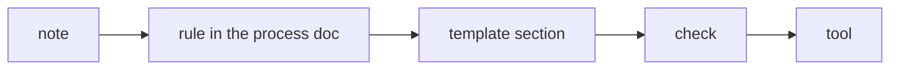
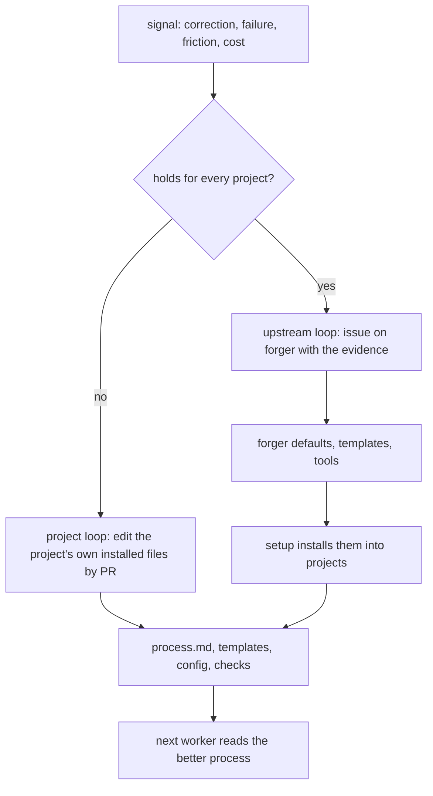

# Refining the process

The loop is only as good as the process the workers read. That process is not
designed up front; it is grown, one correction and one failure at a time. This
document is the process for growing it.

## The signals

Refinement starts from one of five signals. Each is captured the moment it
happens, not at the end of a session.

| Signal | Example | Captured as |
|---|---|---|
| **An owner correction** | "An upgrade should only be added to a record if it was paid for at the time" | the owner's words, dated, verbatim |
| **An owner standing rule** | "Make sure every ticket includes instructions to update docs, examples, help, in every language" | the owner's words, dated, verbatim |
| **A failure in a run** | a worker hung for 37 hours on a wait that matched itself | a timeline from the transcript and the logs |
| **Repeated friction** | the same CI failure found one run at a time, three tickets in a row | the tickets and runs where it recurred |
| **Cost** | a run that took twice its budget; a flaky test retried across many runs | the measurement and the command that produced it |

A signal the owner gives in passing ("good work", "that was too wordy") counts:
confirmed approaches are as worth keeping as corrections, or the process drifts
away from what already works.

## The ladder

Every captured signal becomes the cheapest durable form that will actually be
followed. Forms, from weakest to strongest:

1. **A memory note.** One fact per file, with the owner's words, why it matters
   and how to apply it. Read by the supervisor at the start of every session.
   Cheap, but only the supervisor reads it.
2. **A rule in the process doc.** Read by every worker at the start of every
   ticket. The right home for anything a worker must do differently.
3. **A section in the ticket or PR template.** Makes the rule impossible to
   forget when writing a ticket: an empty section is visible. ("Languages: none"
   is a decision; a missing "Languages" section is a gap.)
4. **A check.** A test, a lint rule, a script in the gates or CI. The rule now
   holds whether or not anyone remembers it. "A missing translation fails a
   check, not a person's memory."
5. **An engine or skill change.** For failures of the loop itself: timeouts,
   counting, process handling. Filed against the engine, with the evidence.

Climb only as far as the rule needs. A one-off preference stays a note. A rule
every worker needs goes in the process doc. A rule that has been broken once
after being written down earns a template section or a check.

### Worked example: languages

- The owner: "new features and updates require a language review."
  -> a memory note, and a process ticket.
- The process ticket added a "Languages" section to the process doc and the
  ticket template.
- The owner later: human review is a nice-to-have, never a gate.
  -> the rule changed in one place, the decision recorded with its number.
- Messages missing in a language now fail the message parity check, and help
  articles out of date fail `help:stale`. The rule no longer depends on anyone.
- The owner later: "every ticket includes instructions to update docs, examples,
  help content, in every language."
  -> a new ticket section, written into the process doc and the tracker guide
  in one supervisor PR, applied at once to the open tickets, and recorded in
  memory.

### Worked example: a run that timed out after merging

- Signal: a worker merged its PR and was killed ten minutes later while writing
  its summary; the engine counted a failure.
- Timeline from the transcript: where the time went, phase by phase.
- Two forms: a process rule ("push the moment the gates are green, before
  anything slow") and an engine change (count a timed-out run by its outcome).

## Two loops

A lesson lands in one of two places, and the difference is who else needs it.

A project refines the files that setup installed into it and owns them from then
on. A lesson that is true everywhere is filed against forger, so every project
gets it at the next setup or update.

## The steps

1. **Capture** the signal verbatim, with the date and its source.
2. **Find the cause.** For a failure, build a timeline from the worker's session
   transcript (time per tool and phase) and from CI's logs. For friction, list
   every place it recurred. Do not stop at the first plausible cause; the
   37-hour hang looked like a worker bug and was an engine bug underneath.
3. **Choose the form** on the ladder.
4. **Check for an existing rule** that covers it. Update that rule rather than
   adding a second; delete rules that turned out wrong.
5. **Write it** where its readers will read it, in the owner's terms. Say why,
   so a future reader can judge edge cases instead of following blindly.
6. **Apply it now** to the open work it affects (reword open tickets, widen a
   ticket), not only to future work.
7. **Land it through the same gate as code:** a PR, reviewed or at least
   visible, so the history of the process is in git.
8. **Tell the owner** in one line what changed and where.

## Hygiene

Rules accrete. Without care the process doc becomes a pile of gotchas no worker
can hold in mind.

- **One rule, one place.** Other places point to it.
- **Latest decision wins.** Decisions get numbers in a decision log; a rule cites
  the number, so a later decision visibly supersedes it.
- **No transient specifics.** No counts, sizes, timings or dates in a rule; point
  at the command that computes them.
- **Gotchas are debt.** A gotcha in the process doc is a check that has not been
  written yet. Periodically turn the most-hit gotchas into checks and delete the
  prose.
- **Prune.** A rule that no worker has needed in a long time, or that a check now
  enforces, is removed.
- **Memory is not the repo.** A memory note never holds what the code or git
  already records. Notes naming files or flags are verified before they are
  relied on.

## Measuring the process

The process is working when, over time:

- fewer runs time out or fail, and a failure leaves enough behind to diagnose;
- a ticket needs fewer CI rounds before it merges;
- the owner corrects the same thing less often;
- the per-ticket cost and time fall without the budget rising.

Each of these comes from a command over the engine's state, the logs and CI, not
from a number written in a doc. `measure --json` reports runs and failures by
cause, the terminal events, and the time, budget cap and CI rounds per ticket,
over all runs or the last N. `/forger:retro` runs it to find a cause, writes a
rule record with `retro rule`, and drafts an upstream issue with the evidence
using `retro upstream`.

## Cadence

- **Immediately:** after any halt, timeout, misbuilt ticket or owner correction.
- **Periodically:** a review of the last stretch of runs: time and cost per
  ticket, failure causes, the most-hit gotchas, rules to promote or prune.
- **On demand:** when the owner asks "how do we stop this happening again".

The supervisor proposes; the owner approves changes to the playbook itself.
