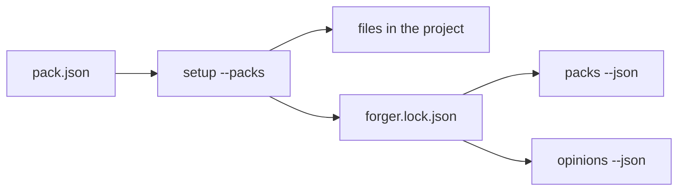
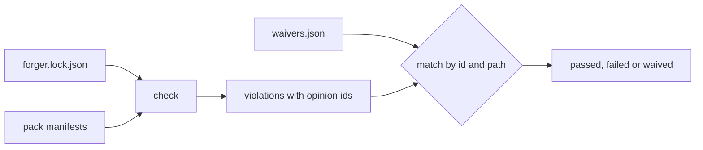

# Opinion packs

Forger holds opinions about how work is done. A pack is a named, versioned set of them, together with the files and checks that carry them. `setup` installs packs into a project, and the lock records what was installed.

## What a pack is

A pack is a directory under `plugins/forger/packs/<name>/`:

- `pack.json`, the manifest: `id`, `version`, `description`, `detect`, `files`, `opinions`, `checks` and `slots`.
- The files it installs, each mapped to a path in the project by the manifest.

An opinion has an id of the form `<pack>.<name>`, a one-line summary, a rung and, when its rung is `check`, the id of the check that enforces it. The manifest is validated when it is loaded; a bad manifest is an error that names the field, never a pack that quietly goes missing.

## The rungs

An opinion's rung is how strongly it holds, taken from the refinement ladder in [`05-refining-the-process.md`](05-refining-the-process.md): `note`, `rule`, `template`, `check`, `tool`. The ladder ends in a check or a tool because prose is a waypoint, not the destination ([ADR 0002](adr/0002-determinism-first.md)).

## Installing and the lock

Read it left to right: `setup` reads each chosen pack's manifest, writes its files where they are absent, and records the pack and the hash of each file it wrote in the lock. `packs` and `opinions` read the lock to say what is held.

`setup` never overwrites. A second run writes nothing, and the lock keeps the hash recorded when the file was installed, so a later upgrade can tell a file the project edited from one it did not. A file the project already had is kept and is not recorded, because forger did not install it.

## Commands

- `setup --packs base[,<name>...]` installs by pack; the default is `base`.
- `packs --json` lists the available packs and which are installed.
- `opinions --json` lists every installed opinion with its pack, rung and enforcing check, or none.

## Checks and waivers

Read it left to right: `check` takes the checks that the locked packs declare, in lock order, runs each, and matches every violation against the waivers by opinion id and path glob. A check is `passed` with no violations, `waived` when every violation is covered, and `failed` otherwise; any failed check makes the exit code non-zero.

`.claude/waivers.json` is how a project switches an opinion off in the open. Each entry names the opinion, a path glob, a reason and who approved it; an entry missing the reason or the approver is an error, not a waiver. A waiver that matches no violation is reported as stale, so it gets deleted once it is no longer needed.

- `check --json` runs everything and reports per check, plus the stale waivers. `/forger:retro` reads it for the waiver list.
- `check docs` runs the docs check alone, without waivers: the writing rules always, and, when the `docs` pack is installed, the content rules below.
- `setup` appends `check` to the gates.

## The docs pack

The `docs` pack holds the docs habits: Markdown in the repository, a diagram and a reading sentence for every concept, a page that shows each feature, decisions as ADRs. Four of its opinions are enforced by `check docs`, each under its own opinion id so a waiver can target one:

| Opinion | What the check flags |
|---|---|
| `docs.links-resolve` | a relative link or `#anchor` that points at no file or heading |
| `docs.images-resolve` | an image link that points at no file in the repository |
| `docs.diagrams-parse` | a mermaid block with an unknown type, unbalanced brackets or quotes, an arrow with a missing end, or an unclosed subgraph |
| `docs.glossary-terms` | a word from a glossary `_Avoid_:` list, used in prose |

Read the table as a list of ways docs rot quietly. Code spans and fences are never prose, so quoting an avoided word in backticks is fine. A word that is only wrong in one sense carries a parenthetical in the glossary, such as `user (when meaning the owner)`, and is not enforced because a pattern cannot tell the senses apart. Diagram parsing is structural rather than a full mermaid parse: it needs no browser or extra dependency and covers the mistakes that break a render, but it does not validate the grammar of every diagram type.

The decision to use packs is [ADR 0003](adr/0003-opinion-packs.md).
