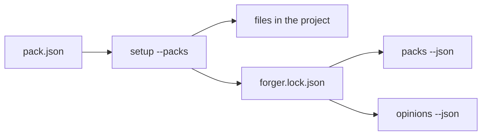
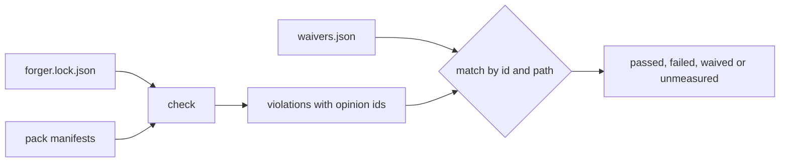
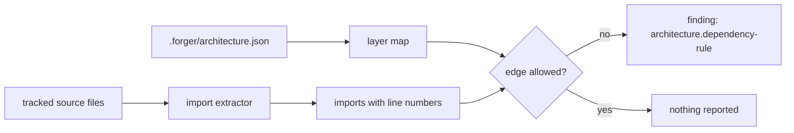
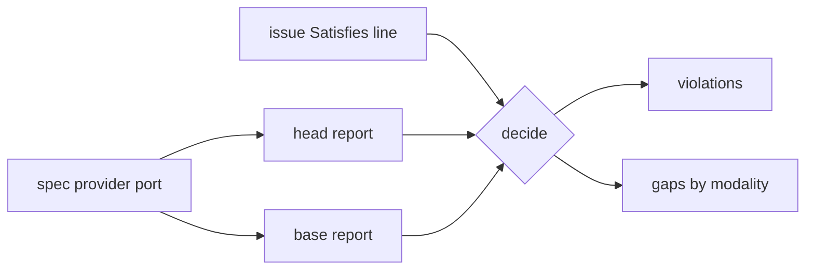

# Opinion packs

Forger holds opinions about how work is done. A pack is a named, versioned set of them, together with the files and checks that carry them. `setup` installs packs into a project, and the lock records what was installed.

## What a pack is

A pack is a directory under `plugins/forger/packs/<name>/`:

- `pack.json`, the manifest: `id`, `version`, `description`, `detect` (rules of the form `file:<path>`, `dir:<path>` or `dep:<name>`), `files`, `opinions`, `checks` and `slots`.
- The files it installs, each mapped to a path in the project by the manifest.

An opinion has an id of the form `<pack>.<name>`, a one-line summary, a rung and, when its rung is `check`, the id of the check that enforces it. The manifest is validated when it is loaded; a bad manifest is an error that names the field, never a pack that quietly goes missing.

## The rungs

An opinion's rung is how strongly it holds, taken from the refinement ladder in [`05-refining-the-process.md`](05-refining-the-process.md): `note`, `rule`, `template`, `check`, `tool`. The ladder ends in a check or a tool because prose is a waypoint, not the destination ([ADR 0002](adr/0002-determinism-first.md)).

## Installing and the lock

Read it left to right: `setup` reads each chosen pack's manifest, writes its files where they are absent, and records the pack and the hash of each file it wrote in the lock. `packs` and `opinions` read the lock to say what is held.

`setup` never overwrites. A second run writes nothing, and the lock keeps the hash recorded when the file was installed, so a later upgrade can tell a file the project edited from one it did not. A file the project already had is kept and is not recorded, because forger did not install it.

## Commands

- `setup --packs base[,<name>...]` installs by pack; the default is `base`.
- `packs --json` lists the available packs and which are installed.
- `packs --detect --json` suggests packs not yet installed, each with the rules that matched. The facts come from one thin reader (files, directories and the root `package.json` dependencies); a pack with no `detect` rules is never suggested, only listed. `setup` offers the suggestions and the owner chooses.
- `opinions --json` lists every installed opinion with its pack, rung and enforcing check, or none.

## Checks and waivers

Read it left to right: `check` takes the checks that the locked packs declare, in lock order, runs each, and matches every violation against the waivers by opinion id and path glob. A check is `passed` with no violations, `waived` when every violation is covered, and `failed` otherwise; any failed check makes the exit code non-zero.

A check can also report a coverage gap: something it could not measure. A gap is neither a pass nor a failure, so a check with an open gap is `unmeasured`, never `passed`. The requirement's modality sets the severity: a MUST gap fails the check, a SHOULD gap warns, a MAY gap informs. A waiver matches a gap by opinion id and path like any finding, so a SHOULD is a waivable warning and a MUST stays failed until an approver signs a waiver. `check --json` lists gaps apart from violations, per check and as one flat list. The mapping is a pure function with table tests.

`.forger/waivers.json` is how a project switches an opinion off in the open. Each entry names the opinion, a path glob, a reason and who approved it; an entry missing the reason or the approver is an error, not a waiver. A waiver that matches no violation is reported as stale, so it gets deleted once it is no longer needed.

- `check --json` runs everything and reports per check, plus the stale waivers. `/forger:retro` reads it for the waiver list.
- `check docs` runs the docs check alone, without waivers: the writing rules always, and, when the `docs` pack is installed, the content rules below.
- `setup` appends `check` to the gates as `bun "$FORGER_PLUGIN_ROOT/bin/work.ts" check`. The committed line holds no machine path: the engine exports `FORGER_PLUGIN_ROOT`, the root of the plugin it runs from, to the worker that runs the gates, so the same gates work on any machine. Outside the engine, export the variable yourself before running the gates. `setup --upgrade` rewrites an older absolute check command to this form.

## The docs pack

The `docs` pack holds the docs habits: Markdown in the repository, a diagram and a reading sentence for every concept, a page that shows each feature, decisions as ADRs. Its check opinions are enforced by `check docs`, each under its own opinion id so a waiver can target one:

| Opinion | What the check flags |
|---|---|
| `docs.links-resolve` | a relative link or `#anchor` that points at no file or heading |
| `docs.images-resolve` | an image link that points at no file in the repository |
| `docs.diagrams-parse` | a mermaid block with an unknown type, unbalanced brackets or quotes, an arrow with a missing end, or an unclosed subgraph |
| `docs.glossary-terms` | a word from a glossary `_Avoid_:` list, used in prose |
| `docs.readme-purpose-first` | a README whose first paragraph after the H1 is missing or longer than two sentences |
| `docs.readme-short-sentences` | a README step over 20 words, a sentence over 25, or a paragraph over 6 sentences |
| `docs.readme-active-voice` | a passive construction in a README; a warning on stderr, never a failure |
| `docs.readme-no-transient` | a count of things, a date, "currently", "recently", "new" or a version number in README prose |

Read the table as a list of ways docs rot quietly. Code spans and fences are never prose, so quoting an avoided word in backticks is fine. A word that is only wrong in one sense carries a parenthetical in the glossary, such as `user (when meaning the owner)`, and is not enforced because a pattern cannot tell the senses apart. The README rules are the measurable part of ASD-STE100 Simplified Technical English (ADR 0017). Code, tables and quotes are skipped, and READMEs under `node_modules` and `fixtures` are not checked. Diagram parsing is structural rather than a full mermaid parse: it needs no browser or extra dependency and covers the mistakes that break a render, but it does not validate the grammar of every diagram type.

## The architecture pack

The `architecture` pack holds the architecture forger is built on: pure decisions with I/O at the edges, every external system behind a port, parse at the boundary, fail loud, one source of truth per fact, and deep modules. Two of its opinions are enforced: `architecture.dependency-rule` by `check arch`, and `architecture.decisions-recorded` by `check decisions`.

Read it left to right: the layer map names layers as path globs and says which layer may import which; the extractor lists each file's imports; any import whose edge the map forbids becomes a finding on the importing line.

A layer may always import itself, and files outside every layer, packages and builtins are not constrained. Static, type-only, dynamic, `require` and re-export imports all count. TypeScript and JavaScript are read today; another language is another entry behind the import-extractor interface. A missing or malformed layer map is an error, never a pass. Forger installs the pack on itself and marks its pure modules as the core layer.

### Decisions leave an ADR behind

`check decisions` reads the working tree and branch against the merge-base with the configured base branch. A dependency added to a manifest (`package.json` today; another manifest is another entry behind the manifest-reader interface), or any change to `.forger/architecture.json`, needs a new or changed Markdown file under `docs/adr/` in the same diff. A version bump or a removed dependency is classified and needs no ADR. The pack ships an ADR template with context, decision, consequences and status; an accepted ADR is superseded by a new one, never edited. Like every opinion, it is waivable in `.forger/waivers.json`. A base branch that cannot be resolved is an error, never a pass.

The decision to use packs is [ADR 0003](adr/0003-opinion-packs.md).

## The safety pack

The `safety` pack holds principle 9 (data in production is sacred) and the never-commit-a-secret rule. Two of its opinions are enforced by `check safety`, each under its own opinion id so a waiver can target one:

| Opinion | What the check flags |
|---|---|
| `safety.secrets` | an added line, in the diff or an untracked file, that matches a known credential pattern, or an added `.env` file |
| `safety.data-forward` | a diff that touches `migration_paths` without adding or changing a test under `data_test_paths` |

Both lists live in `.forger/safety.json`. A finding names the file, line and pattern and never prints the match, so a report does not spread the secret it found. The other two opinions, frozen lockfiles in the gates and destructive commands listed in the process gotchas, are rules kept by judgement. Like `check decisions`, the check reads the working tree and branch against the merge-base with the configured base branch, and an unresolvable base is an error, never a pass.

## The testing pack

The `testing` pack holds the testing habits the engine itself relies on. Three of its opinions are enforced, each under its own opinion id so a waiver can target one:

| Opinion | Check | What it flags |
|---|---|---|
| `testing.fix-with-test` | `check tests` | a branch with a `fix:` commit that adds or changes no file matching `test_paths` |
| `testing.no-network` | `check tests` | a unit test file that imports a library named in `network_modules`; files under `integration_paths` are exempt |
| `testing.coverage-ratchet` | `check coverage` | line coverage below the generated baseline, or no baseline yet |

The globs and library list live in `.forger/testing.json`, with the path of the lcov report the project's test command writes and the path of the baseline. The baseline is a generated file: `check coverage --update` creates it or raises it, and never lowers it, so the number lives only there and a deliberate drop is a recorded waiver. A missing or empty coverage report is an error, never a pass. The other opinions (tables for the pure core, fixtures for adapters, tests named for behaviour) are rules kept by judgement. Like `check decisions`, `check tests` reads commits and the working tree against the merge-base with the configured base branch.

## The ui pack

The `ui` pack makes a UI change reviewable by showing it. Evidence, colour tokens and accessibility are enforced; the rest are templates and rules:

| Opinion | Rung | What it asks |
|---|---|---|
| `ui.evidence` | check (`check ui`) | a branch that changes a file matching `paths` also adds or updates a file under `docs/screenshots/` |
| `ui.tokens` | check (`check ui`) | files under `paths` hold no raw colour literal (hex, `rgb()`, `hsl()`) outside the files named by `tokens`; comments are ignored |
| `ui.a11y` | tool (`check a11y`) | axe-core runs on every route at every viewport and theme; serious and critical violations fail |
| `ui.keyboard`, `ui.contrast`, `ui.responsive` | rule | interactive elements work by keyboard, text contrast meets WCAG AA, layouts hold at phone width |
| `ui.wireframe` | template | a ticket that changes a screen gets a wireframe under `docs/design/<ticket>/` first, and the build ticket waits for the owner to approve it |
| `ui.screenshots-in-pr` | template | the PR body's Screenshots section links the updated files at the head commit |
| `ui.captures-in-pr` | template | interactive or animated work is recorded by `screenshot --capture <name>` and the PR body's Captures section links the updated videos at the head commit |
| `ui.states` | template | the ticket's UI states section says what the screen shows when empty, loading, failed and full |

`.forger/ui.json` holds `paths`, the `start` command that serves the app, its `url`, the `routes`, the `viewports` (a phone and a desktop by default) and the `themes` (light and dark). `screenshot` starts the app, waits for it, captures every route x viewport x theme with the project's own Playwright into `docs/screenshots/<route>-<viewport>-<theme>.png`, stops the app and reports the files. The matrix and the names are computed from the config, so a re-run overwrites the same files. When Playwright or the app is unavailable the command says so and exits 2, an environment problem apart from a bad config (exit 1). An optional `captures` list declares scripted interactions (a name, a route, a viewport, steps and a maximum length); `screenshot --capture <name>` records one with Playwright's video recording into `docs/screenshots/<name>.webm`, and a GIF beside it when `ffmpeg` is installed (exit 2 with how to add it when not, the video still written). `check ui` counts an updated capture as evidence like a still. Feature docs can embed the images, so they stay current with each UI change. The pack adds the `design` skill slot: its built-in step is a static grey-box wireframe in `docs/design/<ticket>/index.html` linking the shipped `wireframe.css`, captured by `screenshot --wireframe <ticket>`, which serves `docs/design/` itself and writes the images beside the page. Wireframes are for screens and diagrams for processes (the docs pack). `check a11y` serves the app the same way and audits each page with the project's own Playwright and `axe-core`; it needs a browser, so it runs on its own rather than inside the umbrella `check`, and exits 2 when the environment lacks either library. Violations are mapped from axe's output by a pure function. Like `check decisions`, `check ui` reads the working tree and branch against the merge-base with the configured base branch.

## The creative pack

The `creative` pack is for games, demos, animation and canvas-heavy projects, installed beside `ui`. It exists because the `ui` pack's grey wireframe carries no colour to argue about, so an owner approves a layout and never a look, and a tokens rule plus a test of pixel counts can lock a drab palette in. It is detected from a canvas, game-engine or animation dependency; `plan` also recommends it when `intent` classifies the request as creative. Its opinions are templates and rules; none has a mechanical check:

| Opinion | Rung | What it holds |
|---|---|---|
| `creative.style-frame` | template | a ticket that changes how a screen looks gets one finished frame in the real palette under `docs/design/<ticket>/`, rendered by `screenshot --wireframe` and approved by the owner before screens are built on it |
| `creative.brief-fit`, `creative.juice`, `creative.glanceable` | template | the ticket says how it serves the verbatim brief, the visual, motion and sound feedback for each player action or event, and what a viewer must understand within a few seconds, with a time-to-first-interaction budget |
| `creative.palette-tokens`, `creative.no-style-locking-tests` | rule | colours come from tokens and a palette is a set of tokens; review flags a test that locks a style choice instead of a behaviour |
| `creative.reduced-motion` | rule | motion respects the reduced-motion setting |
| `creative.original` | rule | nothing from an existing work is reproduced |

The pack installs `.forger/templates/ticket-creative.md` (the base ticket with the brief-fit, juice and readable-at-a-glance sections), an example style frame under `docs/design/style-frame/` and the opinions doc, never overwriting. It adds no skill slot of its own: the `design` slot gains a second built-in step through the shipped `creative` flavour (`setup --flavour creative`), which resolves `design` to forger's style-frame skill; every other flavour keeps the grey wireframe. The style-frame step leaves the same `wireframe` contract. With the `ui` pack installed, `check ui` already fails raw colour literals outside the token files.

## The spec pack

The `spec` pack keeps requirements checked after merge ([ADR 0007](adr/0007-spec-pack-requirements-that-stay-checked.md)). The spec holds the current state and the issue is the unit of change: a ticket carries a `Satisfies:` line naming requirement IDs, and the spec never names an issue. `check spec` joins the IDs the branch's issue names (`feat/issue-<n>`), the requirement report and the base branch's report, and decides purely from them. A ticket's acceptance criterion can also be bound to a requirement by writing `[spec:ID]` in its text: when the head's report shows that requirement satisfied, `verify` records the criterion `met` with the spec check as evidence and leaves it out of what the verifier judges ([ADR 0010](adr/0010-an-independent-verifier-checks-acceptance-before-merge.md)).

Read it left to right: a provider behind a port yields the head and base reports in one normalized shape, and the pure decision turns them with the named IDs into violations and gaps. Any provider yields the same shape, so the check does not care which tool read the spec.

| Opinion | Rung | What the check does |
|---|---|---|
| `spec.ticket-names-requirements` | check | flags an issue with no `Satisfies:` line; an unreadable issue is a gap |
| `spec.named-requirements-satisfied` | check | an unsatisfied named MUST is a violation; an unsatisfied SHOULD warns and a MAY informs; an unknown or missing named ID is a gap at its modality |
| `spec.must-never-regresses` | check | a MUST satisfied on the base and not satisfied now is a violation, named or not |
| `spec.validator-not-requirement` | rule | a failing validator never loosens a requirement; it changes only through intake |

A missing provider, or a missing base report, is a coverage gap, never a pass. `check spec --json` also reports the requirement counts by state, so the share still unknown is read from the report. The first provider runs the `slcr` binary (`check --format json`, `query`, `slice`) and parses its output at the boundary into the normalized report; an output whose shape has changed is reported as a gap naming the field. Without the binary the check reports the gap. `slice <ID...>` prints the context for each requirement a ticket names, and the worker reads it before building.
