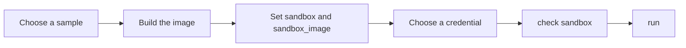

# Run sandboxed

A worker runs on the host by default. The sandbox is opt-in: you choose it, and nothing changes until you do. In a sandbox, each worker runs in its own container. It cannot read your other repositories or your home folder ([ADR 0019](adr/0019-workers-run-in-a-sandbox-behind-an-adapter.md)).

The image is yours. Forger publishes none. It gives you samples to copy and a command that tests your image.



The diagram shows the order: choose, build, configure, pick a credential, test, run.

## 1. Choose a sample

The samples are in [`examples/sandbox/`](../examples/sandbox/README.md).

- **The devcontainer.** Copy `examples/sandbox/devcontainer/.devcontainer/` to the root of your repository. Forger uses it, and so does your editor. This is the recommended path.
- **A Dockerfile.** Use `node/` or `python/` when you do not want a devcontainer.

## 2. Build it

For a Dockerfile sample:

```sh
docker build -t my-worker -f examples/sandbox/node/Dockerfile examples/sandbox/node
```

A devcontainer needs no build step here: forger builds it from the repository.

## 3. Set the sandbox and the image

```sh
bun plugins/forger/bin/work.ts setup --sandbox docker
```

Setup records `sandbox: docker` and checks that the Docker API answers. For a Dockerfile image, also set `sandbox_image` in `.forger/workloop.config.json`:

```json
{"sandbox": "docker", "sandbox_image": "my-worker"}
```

## 4. Choose a credential

Pass `--credential api_key` or `--credential subscription` to setup. For a subscription, setup says how to make a token for headless use. Put the credential in the environment that starts the run. The [adapters reference](reference/adapters.md#credentials-in-a-sandbox) lists the variables for each harness.

## 5. Test the image

```sh
bun plugins/forger/bin/work.ts check sandbox
```

It prints one line for each item of the contract and exits 0 only when all pass.

## 6. Run

```sh
bun plugins/forger/bin/work.ts run
```

To start the engine itself in a container, set `sandbox_engine_image` to an image built from `examples/sandbox/engine/Dockerfile`, then run:

```sh
bun plugins/forger/bin/work.ts run --detach
```

Without `sandbox_engine_image`, the start is refused and the message names the field.
