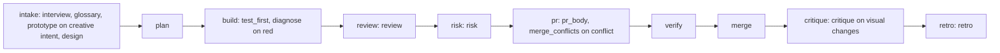

# Automating community skills through the factory

Forger carries a complete set of its own steps, and any installed skill
collection can take over a step. This page shows how the two fit: the pipeline
the loop runs, the slot at each stage, which skill each collection offers there,
and one request travelling through all of it.

The collections have a page each: [agent-skills](agent-skills.md),
[mattpocock-skills](mattpocock-skills.md) and [pstack](pstack.md).

## The pipeline is data

The loop's stages are a definition file, not prose
([ADR 0016](../adr/0016-the-pipeline-is-data-resolved-per-ticket-from-a-flavour.md)).
Each stage names its command, its inputs, the skill slots it runs, and the gate
that must hold before the next stage. A project overlays its own stages in
`.forger/`.

A **flavour** picks, per slot, an ordered list of candidates: a skill or a file,
each with optional conditions on the ticket (labels, paths, installed packs). The
first candidate whose conditions hold and which is installed wins. Forger's own
step is always the last candidate, so a missing skill never stalls the loop.
`default` is forger's own step for every slot; the collection flavours map a
collection onto the slots it fits; `mixed` takes the strongest fit per slot
across all three.

`pipeline --json` shows the outcome for one ticket, the winner per slot and why
each earlier candidate lost:

```
bun plugins/forger/bin/work.ts pipeline --json --issue 150
```



Every slot hands its result through an output contract, and a gate checks it
before the stage ends. A skill written for a human runs unattended: the engine
wraps each invocation in a preamble (never ask the owner, never commit, push or
merge, never route to another skill or start a loop), and a flavour's `forbid`
list names the skills of its collection that own the process and so must not run.

## What each collection offers per stage

An empty cell means the collection has no genuine fit and forger's own step runs.

| Stage | Slot | agent-skills | mattpocock-skills | pstack |
|---|---|---|---|---|
| intake | interview | `interview-me` | `grilling` | - |
| intake | glossary | `documentation-and-adrs` | `domain-modeling` | - |
| intake | prototype | - | - | - |
| intake | design | - | - | - |
| build | test_first | `test-driven-development` | `tdd` | `tdd` (file) |
| build | diagnose | `debugging-and-error-recovery` | `diagnosing-bugs` | - |
| review | review | `code-review-and-quality` | `code-review` | `interrogate` (file) |
| risk | risk | `doubt-driven-development`, `security-and-hardening` | - | `blast-radius` (file) |
| pr | pr_body | - | `pr` | - |
| pr | merge_conflicts | - | - | - |
| critique | critique | - | - | - |
| retro | retro | - | `retro` (file) | `reflect` (file) |

A skill that refuses model invocation, or that a human invokes by name, runs as a
file slot: forger reads its `SKILL.md` and follows it.

## Using it

Install a collection, then record the flavour:

```
bun plugins/forger/bin/work.ts setup --flavour mixed
```

`setup --preset <name>` is the same command. `/forger:setup` lists the flavours
whose collection is installed and offers each. The config pins the choice as
`name@version`, so a flavour that changes under you is refused until you move the
pin. To change one slot only, set it in the config's `skills` map, which wins per
slot; to change a candidate order or add a condition, copy the flavour to
`.forger/flavours/` and edit it.

## One request through the mixed flavour

The owner says: "let people export their settings".

1. **Intake.** `plan` runs the interview slot: `grilling` from mattpocock-skills
   puts the open decisions to the owner (which format, which settings), one at a
   time with a recommended answer. The glossary slot runs `domain-modeling`,
   which records the term "export" in `GLOSSARY.md`. A ticket labelled `ui` also
   gets the design slot, which has no collection fit, so forger's wireframe step
   runs.
2. **Plan.** `auto-plan` turns the decisions into tickets in the backlog. No slot
   runs here.
3. **Build.** The worker takes one ticket. `test_first` runs `tdd` from
   mattpocock-skills: failing test, then the change. If a gate goes red, the
   `diagnose` slot runs `diagnosing-bugs`.
4. **Review.** `code-review-and-quality` from agent-skills reviews the diff
   against the ticket and leaves `review_findings`.
5. **Risk.** `blast-radius` from pstack, read as a file, lists what the change
   touches beyond the diff. A ticket labelled `security` gets
   `security-and-hardening` instead.
6. **PR.** `pr_body` runs `pr` from mattpocock-skills; forger checks the body
   against the ticket shape. If the rebase conflicts, forger's own step resolves
   it.
7. **Verify and merge.** Tools, no slots: `verify` records a verdict for the
   head, and `merge` squash-merges only on green.
8. **Retro.** `retro` reads mattpocock-skills' retro skill as a file and proposes
   how the process should change, which the refinement loop then lands.

Run `pipeline --json` on the real ticket to see which candidate won each slot.
